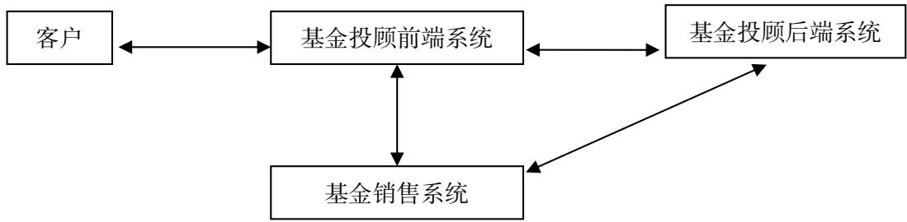

# 公开募集证券投资基金投资顾问业务数据交换技术接口规范（试行）

2021年9月

## 目录

目录.  
前言…  
1. 范围..  
2. 规范性引用文件....  
3. 术语和定义..….  
4. 系统框架.……  
5. 文件业务码…  
6. 交易模式..  
6.1 交易模式一  
6.2 交易模式二.  
7.基础要求……  
7.1 文件传输..  
7.2 数据类型...  
7.3 文件规范... 10  
7.4 其他要求.. .11  
8. 业务数据交换接口传输文件的内容和格式.  
8.1基金投顾服务签约解约申请（201） .11  
8.2 客户基本信息（001） .12  
8.3基金投资组合策略转入申请（202） .17  
8.4基金投资组合策略转出申请（203） .. 18  
8.5基金投顾服务签约解约确认（301） .. 19  
8.6基金投资组合策略转入交易指令（101） .19  
8.7基金投资组合策略转出交易指令（102） .20  
8.8基金投资组合策略调仓交易指令（103） .22  
8.9基金投资组合策略成分基金分红方式设置（104）（可选） .23  
8.10基金交易申请结果（002） .24  
8.11基金交易确认结果（003） ..25  
8.12客户存量份额（004） .27  
8.13客户在途资产（005） 27  
8.14客户资金信息（006）（可选） .28  
8.15基金净值及交易信息（007） .29  
8.16基金投资组合策略基本信息（302） .31  
8.17基金投资组合策略行情（303） .34  
8.18基金投顾费用收取指令（105） 34  
8.19客户资产收益（304） ...36  
8.20基金投资组合策略报告信息（305）（可选） ...36  
9. 附录.. .….37  
9.1 错误码列表.. .. 37  
9.2 数据字典.. ...37

## 前言

本文件基于《关于做好公开募集证券投资基金投资顾问业务试点工作的通知》制定。

## 公开募集证券投资基金投资顾问业务数据交换技术接口规范（试行）

## 1. 范围

《公开募集证券投资基金投资顾问业务数据交换技术接口规范以下简称《接口规范》)规定了公开募集证券投资基金投资顾问业务（以下简称“基金投顾业务”）开展中，基金投顾业务试点机构（以下简称“基金投顾机构”）与基金销售机构之间进行数据交换时所采用的数据格式、数据定义和数据内容。基金投顾机构与基金销售机构可参照《接口规范》进行数据交换。

《接口规范》使用对象为基金投顾机构与基金销售机构的业务人员，以及相关系统开发技术人员。《接口规范》可作为机构合规自查的参考文档。

《接口规范》适用于管理型基金投资顾问业务以及非管理型基金投资顾问业务。

## 2. 规范性引用文件

下列文件中的条款通过本标准的引用而成为本标准的条款。凡是注日期的引用文件，其随后所有的修改单（不包括勘误的内容）或修改版均不适用于本标准，然而，鼓励根据本标准达成协议的各方研究是否可使用这些文件的最新版本。凡是不注日期的引用文件，其最新版本适用于本标准。

ISO 3166 国家和地区代码表。

GB/T39595-2020 开放式基金业务数据交换协议。

## 3. 术语和定义

<table><tr><td colspan="1" rowspan="1">业务术语</td><td colspan="1" rowspan="1">定义</td></tr><tr><td colspan="1" rowspan="1">基金投顾机构</td><td colspan="1" rowspan="1">指获得基金投资顾问业务试点资格的机构。</td></tr><tr><td colspan="1" rowspan="1">基金投顾前端系统</td><td colspan="1" rowspan="1">指面对客户的基金投顾服务系统，可以部署在基金销售机构端或基金投顾机构端的部分。</td></tr><tr><td colspan="1" rowspan="1">基金投顾后端系统</td><td colspan="1" rowspan="1">指基金投顾服务系统，仅部署在基金投顾机构端的部分，用于生成投资建议的系统。</td></tr><tr><td colspan="1" rowspan="1">基金投顾系统</td><td colspan="1" rowspan="1">投顾前端系统或投顾后端系统。</td></tr><tr><td colspan="1" rowspan="1">基金销售机构</td><td colspan="1" rowspan="1">指具备基金销售业务资格的机构。</td></tr><tr><td colspan="1" rowspan="1">基金销售系统</td><td colspan="1" rowspan="1">指基金销售机构与基金投顾机构对接的系统，负责执行基金投顾下发的查询、交易等指令，并根据约定给基金投顾机构提供开展业务所需的投顾交易指令执行结果等信息。</td></tr><tr><td colspan="1" rowspan="1">客户</td><td colspan="1" rowspan="1">购买基金投资顾问服务（以下简称“投顾服务”）的自然人、机构和</td></tr><tr><td></td><td>产品。</td></tr></table>

## 4. 系统框架

1、基金投顾系统分为基金投顾前端系统和基金投顾后端系统两部分：基金投顾前端系统可以部署在基金销售机构端或基金投顾机构端，基金投顾后端系统需部署在基金投顾机构端。其中，基金投顾前端系统属于基金投顾机构，由基金投顾机构开发部署，或委托其他机构（含基金销售机构）开发部署。

2、客户的基金投顾服务请求由基金投顾前端系统受理。

3、基金销售系统负责执行基金投顾系统下发的查询、交易等指令，根据约定给基金投顾机构提供开展业务所需的投顾交易指令执行结果等信息。针对基金投资顾问业务所需的数据文件，基金销售系统须按约定时间提供给基金投顾系统。

## 5. 文件业务码

文件业务码在数据交换文件中使用三位编码。其中，第一位表示业务发起的方向，0表示基金销售系统发给基金投顾系统，1表示基金投顾系统发给基金销售系统，2表示基金投顾前端系统发给基金投顾后端系统，3表示基金投顾后端系统发给基金投顾前端系统；第二、三位表示发送的文件序号。

基金投顾系统向基金销售系统提交查询或交易指令，基金销售系统负责执行基金投顾系统提交的指令，并及时把执行结果返回到基金投顾系统。

<table><tr><td colspan="1" rowspan="1">文件业务码</td><td colspan="1" rowspan="1">接口名称</td><td colspan="1" rowspan="1">实现要求</td></tr><tr><td colspan="1" rowspan="1">201</td><td colspan="1" rowspan="1">基金投顾服务签约解约申请</td><td colspan="1" rowspan="1">必须</td></tr><tr><td colspan="1" rowspan="1">001</td><td colspan="1" rowspan="1">客户基本信息</td><td colspan="1" rowspan="1">必须</td></tr><tr><td colspan="1" rowspan="1">202</td><td colspan="1" rowspan="1">基金投资组合策略转入申请</td><td colspan="1" rowspan="1">必须</td></tr><tr><td colspan="1" rowspan="1">203</td><td colspan="1" rowspan="1">基金投资组合策略转出申请</td><td colspan="1" rowspan="1">必须</td></tr><tr><td colspan="1" rowspan="1">301</td><td colspan="1" rowspan="1">基金投顾服务签约解约确认</td><td colspan="1" rowspan="1">必须</td></tr><tr><td colspan="1" rowspan="1">101</td><td colspan="1" rowspan="1">基金投资组合策略转入交易指令</td><td colspan="1" rowspan="1">必须</td></tr><tr><td colspan="1" rowspan="1">102</td><td colspan="1" rowspan="1">基金投资组合策略转出交易指令</td><td colspan="1" rowspan="1">必须</td></tr><tr><td colspan="1" rowspan="1">103</td><td colspan="1" rowspan="1">基金投资组合策略调仓交易指令</td><td colspan="1" rowspan="1">必须</td></tr><tr><td colspan="1" rowspan="1">104</td><td colspan="1" rowspan="1">基金投资组合策略成分基金分红方式设置</td><td colspan="1" rowspan="1">可选</td></tr><tr><td colspan="1" rowspan="1"></td><td colspan="1" rowspan="1"></td><td colspan="1" rowspan="1"></td></tr><tr><td colspan="1" rowspan="1">002</td><td colspan="1" rowspan="1">基金交易申请结果</td><td colspan="1" rowspan="1">必须</td></tr><tr><td colspan="1" rowspan="1">003</td><td colspan="1" rowspan="1">基金交易确认结果</td><td colspan="1" rowspan="1">必须</td></tr><tr><td colspan="1" rowspan="1">004</td><td colspan="1" rowspan="1">客户存量份额</td><td colspan="1" rowspan="1">必须</td></tr><tr><td colspan="1" rowspan="1">005</td><td colspan="1" rowspan="1">客户在途资产</td><td colspan="1" rowspan="1">必须</td></tr><tr><td colspan="1" rowspan="1">006</td><td colspan="1" rowspan="1">客户资金信息</td><td colspan="1" rowspan="1">可选</td></tr><tr><td colspan="1" rowspan="1"></td><td colspan="1" rowspan="1"></td><td colspan="1" rowspan="1"></td></tr><tr><td colspan="1" rowspan="1">007</td><td colspan="1" rowspan="1">基金净值及交易信息</td><td colspan="1" rowspan="1">必须</td></tr><tr><td colspan="1" rowspan="1">302</td><td colspan="1" rowspan="1">基金投资组合策略基本信息</td><td colspan="1" rowspan="1">必须</td></tr><tr><td colspan="1" rowspan="1">303</td><td colspan="1" rowspan="1">基金投资组合策略行情</td><td colspan="1" rowspan="1">必须</td></tr><tr><td colspan="1" rowspan="1">105</td><td colspan="1" rowspan="1">基金投顾费用收取指令</td><td colspan="1" rowspan="1">必须</td></tr><tr><td colspan="1" rowspan="1">304</td><td colspan="1" rowspan="1">客户资产收益</td><td colspan="1" rowspan="1">必须</td></tr><tr><td colspan="1" rowspan="1">305</td><td colspan="1" rowspan="1">基金投资组合策略报告信息</td><td colspan="1" rowspan="1">可选</td></tr></table>

1）由基金投顾系统向基金销售系统发起查询申请，基金销售系统把查询结果先传给基金投顾前端系统，再由基金投顾前端系统传给基金投顾后端系统，或者基金销售系统直接传给基金投顾后端系统。

主要有以下数据文件：

● 客户基本信息（文件业务码：001）

● 基金交易申请结果（文件业务码：002）

● 基金交易确认结果（文件业务码：003）

● 客户存量份额（文件业务码：004）

● 客户在途资产（文件业务码：005）

● 客户资金信息（文件业务码：006）

● 基金净值及交易信息（文件业务码：007）

2）由基金投顾（前端或后端）系统传给基金销售系统，基金销售系统负责执行。

主要有以下数据文件：

● 基金投资组合策略转入交易指令（文件业务码：101）

● 基金投资组合策略转出交易指令（文件业务码：102）

● 基金投资组合策略调仓交易指令（文件业务码：103）

● 基金投资组合策略成分基金分红方式设置（文件业务码：104）

● 基金投顾费用收取指令（文件业务码：105）

3）由基金投顾前端系统传给基金投顾后端系统。

主要有以下数据文件：

● 基金投顾服务签约解约申请（文件业务码：201）

● 基金投资组合策略转入申请（文件业务码：202）

● 基金投资组合策略转出申请（文件业务码：203）

4）由基金投顾后端系统传给基金投顾前端系统。

主要有以下数据文件：

● 基金投顾服务签约解约确认（文件业务码：301）

● 基金投资组合策略基本信息（文件业务码：302）

● 基金投资组合策略行情（文件业务码：303）

● 客户持有策略资产收益（文件业务码：304）

● 基金投资组合策略报告信息（文件业务码：305）

## 6. 交易模式

1、基金投顾机构和基金销售机构经过协商可选用交易模式一或交易模式二。

2、基金投顾机构交易指令应在收盘前下达至基金销售系统。

## 6.1 交易模式一

1、基金投顾前端系统受理客户投顾服务转入、转出申请，通过“基金投资组合策略转入申请（202)”、“基金投资组合策略转出申请（203）”传输至基金投顾后端系统进行处理。

2、基金投顾后端系统收到基金投顾前端系统传输的“基金投资组合策略转入申请（202）”、“基金投资组合策略转出申请（203）”后，处理并生成T日的交易指令文件“基金投资组合策略转入交易指令（101）”、“基金投资组合策略转出交易指令（102）”后再把结果返回给基金投顾前端系统，基金投顾前端系统再返回给基金销售系统，或由基金投顾后端系统直接返回给基金销售系统。对于交易指令执行失败的情况，可由基金投顾后端系统通过“基金投资组合策略转入交易指令（101）”、“基金投资组合策略转出交易指令（102)”发送补单指令，其中对于申购失败的情况也可由基金投顾前端系统根据T-1日下发的“基金投资组合策略基本信息（302）”中信息按优先级申购替补基金。

3、调仓指令由基金投顾后端系统处理并生成T日的交易指令文件“基金投资组合策略调仓交易指令（103)”后再把结果返回给基金投顾前端系统，基金投顾前端系统再返回给基金销售系统，或由基金投顾后端系统直接返回给基金销售系统。

## 6.2 交易模式二

1、基金投顾前端系统受理客户投顾服务转入、转出申请，根据投顾后端系统T-1日下发的“基金投资组合策略基本信息（302)”，基金投顾前端系统生成T日的交易指令直接提交给基金销售系统执行。

2、当基金投顾前端系统受理客户的基金投资组合策略转入申请时，基金投顾前端系统根据投顾后端系统T-1日（建议在交易时段）下发的“基金投资组合策略基本信息（302）”中成分基金信息，生成T日的“基金投资组合策略转入交易指令（101）”转入指令清单及对应的替补基金清单并提交给基金销售系统执行；当基金投顾前端系统受理客户的基金投资组合策略转出申请时，基金投顾前端系统生成T日的“基金投资组合策略转出交易指令（102）”转出指令清单以及基金投顾费用收取指令（105）并提交给基金销售系统执行。其中：

1) 基金销售系统在执行转入指令时，对于替补基金的买入（包括调仓时的买入）优先级约定如下：T-1日下发的“基金投资组合策略基本信息（302）”中的替补基金1的优先级大于替补基金2，替补基金2的优先级大于替补基金3，以此类推，在所有替补基金都无法买入时候，买入指定的兜底货币市场基金（必填项）。

2)基金投资组合策略转出时，按客户最新持有的总份额或可用份额的百分比转出。

3、调仓指令由基金投顾后端系统处理并生成T日的交易指令文件“基金投资组合策略调仓交易指令（103)”后再把结果返回给基金投顾前端系统，基金投顾前端系统再返回给基金销售系统，或由基金投顾后端系统直接返回给基金销售系统。

## 7. 基础要求

## 7.1 文件传输

基金投顾前端系统、基金投顾后端系统和基金销售系统之间的文件传输使用FTP服务器或深证通进行交互。一方在约定的时间将文件上送至指定目录，另一方在约定时间后获取对应业务文件进行业务处理。如采用FTP服务器传输的，可由双方协商约定，由基金投顾机构或基金销售机构提供相应的登录账户，并分配相应的目录访问权限。

文件使用t格式的纯文本文件，传输的文件可以事先约定是否加密以及加密算法，通过公网传输的敏感数据应启用加密处理。另外，传输文件应进行数字签名，防止篡改和抵赖。

文件上传目录应按年月日yyyyMMdd格式建立子目录。

数据传输使用实时接口等其他方式的可参照交换接口传输文件的内容和格式自行约定。

## 7.2 数据类型

本文件中使用的数据类型说明：

<table><tr><td rowspan=1 colspan=1>标识符</td><td rowspan=1 colspan=1>数据类型</td></tr><tr><td rowspan=1 colspan=1>C</td><td rowspan=1 colspan=1>字符型</td></tr><tr><td rowspan=1 colspan=1>A</td><td rowspan=1 colspan=1>数字字符型，限于0—9</td></tr><tr><td rowspan=1 colspan=1>N</td><td rowspan=1 colspan=1>数值型，其长度不包含小数点，可参与数值计算</td></tr><tr><td rowspan=1 colspan=1>TEXT</td><td rowspan=1 colspan=1>不定长文本</td></tr></table>

## 7.3 文件规范

关于批量文件和报送流程的总体要求如下：

1、文件编码方式为UTF-8

2、每行一条完整记录，换行须用回车（0AH）、换行（0DH）字符

3、文件分隔特殊字符：

1）字段分隔符：用单元分隔（1FH）字符

2) 文件中关于<List>的处理方式：

a)字段分隔符：用组分隔（1DH）字符

b)先用“{}”框选一个集合组，在用“[]”框选一个子记录，如：{[a（1DH）b（1DH）c][a（1DH）b（1DH）c]}。

4、如启用加密，双方可自行约定文件加密和数字签名所采用的技术方案。

5、默认情况下文件不压缩；双方可事先商定是否对文件压缩，如果同时需要加密和压缩，则应先按第4步加密并转成字符串后再压缩。压缩默认以gz方式，压缩后的文件名为“原文件名.gz”。

6、文件以FTP服务器共享，以SFTP协议传输。关于SFTP，可事先约定是否验证客户端证书。

7、关于文件服务器的目录规划，应该分开上传和下载两个目录。比如，上传目录（相对于基金投顾机构来说）为\$FTPROOT/up/，下载目录为\$FTPROOT/down/。目前，支持在目录下以yyyyMMdd的格式建立子目录。除以上描述之外，不再支持其他的目录形式。

8、文件名称：

基金投顾机构代码销售人代码8位交易日期文件业务码批次号.txt

基金投顾机构代码销售人代码8位交易日期 文件业务码批次号.txt.ok

基金投顾机构代码销售人代码8位交易日期文件业务码批次号.txt.ok文件必须提供，标明文件是否录入成功，避免文件写入的时候读取文件的情况发生。

其中，基金投顾机构代码和销售人代码由证券期货业标准化组织授权的编码与标准服务机构统一分配和管理。

批次号在一个交易日内按自然数增加，如：001\_001\_20201231\_001\_1.txt、

001\_001\_20201231\_001\_2.txt

## 9、文件内容格式：

第一行为统计信息，接口版本号（1FH）日期（1FH）批次号（1FH）是否是最后一批（0：否，1：是）（1FH）总记录数。

第二行起为明细数据，字段间以“（1FH)”分隔，每条记录占一行。其组成形式如下：序号（1FH）客户编号（1FH）客户姓名（1FH）客户类型（1FH）证件类别（1FH）证件号码证件有效期（1FH）手机号码（1FH）客户风险等级（1FH）风险测评问卷答案（1FH）风险评估到期时间（1FH）专业投资者标志。

EOF作为文件最后一行。

## 7.4 其他要求

1、基金投顾前端系统和基金投顾后端系统均应具备留痕功能。

2、系统应对具体数据字段支持提取查询功能，以便用于合规管理及业务管理。

3、策略代码应由基金投顾机构统一分配和管理，是策略的唯一标识。策略代码应采用基金投顾机构代码开头，总长度不应超过20个字符，字符可为数字或英文字母，英文字母不区分大小写。

## 8. 业务数据交换接口传输文件的内容和格式

## 8.1 基金投顾服务签约解约申请（201）

基金投顾前端系统将客户签约信息以文件形式发送给基金投顾后端系统。

文件数据详述：

<table><tr><td colspan="1" rowspan="1">序号</td><td colspan="1" rowspan="1">字段名</td><td colspan="1" rowspan="1">格式</td><td colspan="1" rowspan="1">必填</td><td colspan="1" rowspan="1">描述</td></tr><tr><td colspan="1" rowspan="1">1</td><td colspan="1" rowspan="1">序号</td><td colspan="1" rowspan="1">C16</td><td colspan="1" rowspan="1">Y</td><td colspan="1" rowspan="1">顺序，唯一</td></tr><tr><td colspan="1" rowspan="1">2</td><td colspan="1" rowspan="1">客户编号</td><td colspan="1" rowspan="1">C18</td><td colspan="1" rowspan="1">Y</td><td colspan="1" rowspan="1">客户的唯一标识</td></tr><tr><td colspan="1" rowspan="1">3</td><td colspan="1" rowspan="1">交易账号</td><td colspan="1" rowspan="1">C32</td><td colspan="1" rowspan="1">N</td><td colspan="1" rowspan="1">根据基金投顾业务开展的相关规定，客户可以委托基金投顾机构管理的基金交易账户</td></tr><tr><td colspan="1" rowspan="1">4</td><td colspan="1" rowspan="1">策略代码</td><td colspan="1" rowspan="1">C20</td><td colspan="1" rowspan="1">Y</td><td colspan="1" rowspan="1"></td></tr><tr><td colspan="1" rowspan="1">5</td><td colspan="1" rowspan="1">投顾业务类型</td><td colspan="1" rowspan="1">C1</td><td colspan="1" rowspan="1">Y</td><td colspan="1" rowspan="1">1-签约，7-解约详见 9.2 数据字典</td></tr><tr><td colspan="1" rowspan="1">6</td><td colspan="1" rowspan="1">投顾问卷答案</td><td colspan="1" rowspan="1">C2000</td><td colspan="1" rowspan="1">N</td><td colspan="1" rowspan="1">JSON 格式：[{"id": "1", "score": "0", "selected": ["1","2"]},{{"id": "2", "score": "10", "selected": ["1"]}]</td></tr><tr><td colspan="1" rowspan="1"></td><td colspan="1" rowspan="1"></td><td colspan="1" rowspan="1"></td><td colspan="1" rowspan="1"></td><td colspan="1" rowspan="1">id是题号，score是获得的分数，selected是选择的答案编号签约时必须填写，解约时不用填写</td></tr><tr><td colspan="1" rowspan="1">7</td><td colspan="1" rowspan="1">签约/解约日期</td><td colspan="1" rowspan="1">A8</td><td colspan="1" rowspan="1">Y</td><td colspan="1" rowspan="1">yyyyMMdd，发生业务的自然日</td></tr><tr><td colspan="1" rowspan="1">8</td><td colspan="1" rowspan="1">签约/解约时间</td><td colspan="1" rowspan="1">A6</td><td colspan="1" rowspan="1">Y</td><td colspan="1" rowspan="1">HH24mmss</td></tr><tr><td colspan="1" rowspan="1">9</td><td colspan="1" rowspan="1">备注</td><td colspan="1" rowspan="1">C2000</td><td colspan="1" rowspan="1">N</td><td colspan="1" rowspan="1"></td></tr><tr><td colspan="1" rowspan="1">10</td><td colspan="1" rowspan="1">网点代码</td><td colspan="1" rowspan="1">C9</td><td colspan="1" rowspan="1">Y</td><td colspan="1" rowspan="1">基金销售机构网点代码</td></tr></table>

## 8.2 客户基本信息（001）

基金销售系统需根据基金投顾前端系统的受理结果，每交易日将当日签约客户的信息以文件形式提供，签约后如客户信息有更新，也应通过该接口文件再次提供给基金投顾后端系统。

文件数据详述：
<table><tr><td rowspan=1 colspan=1>序号</td><td rowspan=1 colspan=1>字段名</td><td rowspan=1 colspan=1>格式</td><td rowspan=1 colspan=1>必填</td><td rowspan=1 colspan=1>描述</td></tr><tr><td rowspan=1 colspan=1>1</td><td rowspan=1 colspan=1>序号</td><td rowspan=1 colspan=1>C16</td><td rowspan=1 colspan=1>Y</td><td rowspan=1 colspan=1>顺序，唯一</td></tr><tr><td rowspan=1 colspan=1>2</td><td rowspan=1 colspan=1>客户编号</td><td rowspan=1 colspan=1>C18</td><td rowspan=1 colspan=1>Y</td><td rowspan=1 colspan=1>客户的唯一标识</td></tr><tr><td rowspan=1 colspan=1>3</td><td rowspan=1 colspan=1>客户姓名</td><td rowspan=1 colspan=1>C300</td><td rowspan=1 colspan=1>Y</td><td rowspan=1 colspan=1></td></tr><tr><td rowspan=1 colspan=1>4</td><td rowspan=1 colspan=1>客户类型</td><td rowspan=1 colspan=1>C1</td><td rowspan=1 colspan=1>Y</td><td rowspan=1 colspan=1>参见9.2数据字典中的“客户类型”</td></tr><tr><td rowspan=1 colspan=1>5</td><td rowspan=1 colspan=1>证件类别</td><td rowspan=1 colspan=1>C3</td><td rowspan=1 colspan=1>Y</td><td rowspan=1 colspan=1>参见9.2数据字典中的“证件类型”</td></tr><tr><td rowspan=1 colspan=1>6</td><td rowspan=1 colspan=1>证件号码</td><td rowspan=1 colspan=1>C50</td><td rowspan=1 colspan=1>Y</td><td rowspan=1 colspan=1></td></tr><tr><td rowspan=1 colspan=1>7</td><td rowspan=1 colspan=1>证件有效期</td><td rowspan=1 colspan=1>A8</td><td rowspan=1 colspan=1>Y</td><td rowspan=1 colspan=1>yyyyMMdd，长期有效填写 99991231</td></tr><tr><td rowspan=1 colspan=1>8</td><td rowspan=1 colspan=1>手机号码</td><td rowspan=1 colspan=1>C24</td><td rowspan=1 colspan=1>N</td><td rowspan=1 colspan=1></td></tr><tr><td rowspan=1 colspan=1>9</td><td rowspan=1 colspan=1>客户风险承受能力</td><td rowspan=1 colspan=1>N10</td><td rowspan=1 colspan=1>Y</td><td rowspan=1 colspan=1></td></tr><tr><td rowspan=1 colspan=1>10</td><td rowspan=1 colspan=1>风险测评问卷答案</td><td rowspan=1 colspan=1>C2000</td><td rowspan=1 colspan=1>N</td><td rowspan=1 colspan=1>JSON 格式</td></tr><tr><td rowspan=1 colspan=1>11</td><td rowspan=1 colspan=1>风险评估到期时间</td><td rowspan=1 colspan=1>A14</td><td rowspan=1 colspan=1>N</td><td rowspan=1 colspan=1>yyyyMMddHH24mmss</td></tr><tr><td rowspan=1 colspan=1>12</td><td rowspan=1 colspan=1>专业投资者标志</td><td rowspan=1 colspan=1>C1</td><td rowspan=1 colspan=1>Y</td><td rowspan=1 colspan=1></td></tr><tr><td rowspan=1 colspan=1>13</td><td rowspan=1 colspan=1>客户详细信息</td><td rowspan=1 colspan=1>C16000</td><td rowspan=1 colspan=1>Y</td><td rowspan=1 colspan=1>根据客户类型传入 json 格式的不同客户信息，具体字段详见下面客户信息表</td></tr><tr><td rowspan=1 colspan=1>14</td><td rowspan=1 colspan=1>影印文件地址</td><td rowspan=1 colspan=1>C255</td><td rowspan=1 colspan=1>N</td><td rowspan=1 colspan=1>该客户所有影印文件存放的存储路径，一般一个客户一个文件夹</td></tr><tr><td rowspan=1 colspan=1>15</td><td rowspan=1 colspan=1>更新时间</td><td rowspan=1 colspan=1>A14</td><td rowspan=1 colspan=1>Y</td><td rowspan=1 colspan=1>yyyyMMddHH24mmss</td></tr><tr><td rowspan=1 colspan=1>16</td><td rowspan=1 colspan=1>网点代码</td><td rowspan=1 colspan=1>C9</td><td rowspan=1 colspan=1>Y</td><td rowspan=1 colspan=1>基金销售机构网点代码</td></tr></table>

客户信息表：

<table><tr><td colspan="1" rowspan="1">英文字段名</td><td colspan="1" rowspan="1">字段名</td><td colspan="1" rowspan="1">格式</td><td colspan="1" rowspan="1">必填</td><td colspan="1" rowspan="1">描述</td></tr><tr><td colspan="5" rowspan="1">个人客户信息 json 开始</td></tr><tr><td colspan="1" rowspan="1">sex</td><td colspan="1" rowspan="1">性别</td><td colspan="1" rowspan="1">C1</td><td colspan="1" rowspan="1">Y</td><td colspan="1" rowspan="1">前面的英文字段名用于 json串数据中的KEY字段名，下同</td></tr><tr><td colspan="1" rowspan="1">vocationCode</td><td colspan="1" rowspan="1">职业代码</td><td colspan="1" rowspan="1">C3</td><td colspan="1" rowspan="1">Y</td><td colspan="1" rowspan="1"></td></tr><tr><td colspan="1" rowspan="1">address</td><td colspan="1" rowspan="1">联系地址</td><td colspan="1" rowspan="1">C255</td><td colspan="1" rowspan="1">Y</td><td colspan="1" rowspan="1"></td></tr><tr><td colspan="1" rowspan="1">nationality</td><td colspan="1" rowspan="1">国籍</td><td colspan="1" rowspan="1">C3</td><td colspan="1" rowspan="1">Y</td><td colspan="1" rowspan="1"></td></tr><tr><td colspan="1" rowspan="1">certificateFrontPhoto</td><td colspan="1" rowspan="1">身份证正面照片</td><td colspan="1" rowspan="1">C255</td><td colspan="1" rowspan="1">N</td><td colspan="1" rowspan="2">图片存储路径、文件名</td></tr><tr><td colspan="1" rowspan="1">certificateBackPhoto</td><td colspan="1" rowspan="1">身份证反面照片</td><td colspan="1" rowspan="1">C255</td><td colspan="1" rowspan="1">N</td></tr><tr><td colspan="1" rowspan="1">nonResiFlag</td><td colspan="1" rowspan="1">税收居民身份</td><td colspan="1" rowspan="1">C255</td><td colspan="1" rowspan="1">Y</td><td colspan="1" rowspan="1">即是否“仅为中国税收居民”，如非则销售渠道保留其税收居民身份扩展信息</td></tr><tr><td colspan="1" rowspan="1">creditFlag</td><td colspan="1" rowspan="1">是否有不良诚信记录</td><td colspan="1" rowspan="1">C1</td><td colspan="1" rowspan="1">Y</td><td colspan="1" rowspan="1">0-没有不良诚信记录1-有不良诚信记录</td></tr><tr><td colspan="1" rowspan="1">creditCause</td><td colspan="1" rowspan="1">不良诚信记录原因说明</td><td colspan="1" rowspan="1">C300</td><td colspan="1" rowspan="1">N</td><td colspan="1" rowspan="1"></td></tr><tr><td colspan="1" rowspan="1">beneOwner</td><td colspan="1" rowspan="1">实际受益人</td><td colspan="1" rowspan="1">C1</td><td colspan="1" rowspan="1">Y</td><td colspan="1" rowspan="1">0-本人1-非本人</td></tr><tr><td colspan="1" rowspan="1">beneOwnerName</td><td colspan="1" rowspan="1">受益人姓名</td><td colspan="1" rowspan="1">C300</td><td colspan="1" rowspan="1">N</td><td colspan="1" rowspan="1">实际受益人为非本人时补充</td></tr><tr><td colspan="1" rowspan="1">beneOwnerCertType</td><td colspan="1" rowspan="1">受益人证件类型</td><td colspan="1" rowspan="1">C1</td><td colspan="1" rowspan="1">N</td><td colspan="1" rowspan="1">实际受益人为非本人时补充</td></tr><tr><td colspan="1" rowspan="1">beneOwnerCertNo</td><td colspan="1" rowspan="1">受益人证件号码</td><td colspan="1" rowspan="1">C50</td><td colspan="1" rowspan="1">N</td><td colspan="1" rowspan="1">实际受益人为非本人时补充</td></tr><tr><td colspan="1" rowspan="1">actualController</td><td colspan="1" rowspan="1">实际控制人</td><td colspan="1" rowspan="1">C1</td><td colspan="1" rowspan="1">Y</td><td colspan="1" rowspan="1">0-本人1-非本人</td></tr><tr><td colspan="1" rowspan="1">actualControllerName</td><td colspan="1" rowspan="1">实控人姓名</td><td colspan="1" rowspan="1">C300</td><td colspan="1" rowspan="1">N</td><td colspan="1" rowspan="1">实际控制人为非本人时补充</td></tr><tr><td colspan="1" rowspan="1">actualControllerCertificateType</td><td colspan="1" rowspan="1">实控人证件类型</td><td colspan="1" rowspan="1">C1</td><td colspan="1" rowspan="1">N</td><td colspan="1" rowspan="1">实际控制人为非本人时补充</td></tr><tr><td colspan="1" rowspan="1">actualControllerCertificateNo</td><td colspan="1" rowspan="1">实控人证件号码</td><td colspan="1" rowspan="1">C50</td><td colspan="1" rowspan="1">N</td><td colspan="1" rowspan="1">实际控制人为非本人时补充</td></tr><tr><td colspan="5" rowspan="1">个人客户信息 json 结束</td></tr><tr><td colspan="5" rowspan="1">机构客户信息 json 开始</td></tr><tr><td colspan="1" rowspan="1">orgNo</td><td colspan="1" rowspan="1">组织机构代码</td><td colspan="1" rowspan="1">C50</td><td colspan="1" rowspan="1">Y</td><td colspan="1" rowspan="1"></td></tr><tr><td colspan="1" rowspan="1">orgNoValidDate</td><td colspan="1" rowspan="1">组织代码有效截止期</td><td colspan="1" rowspan="1">A8</td><td colspan="1" rowspan="1">Y</td><td colspan="1" rowspan="1">yyyyMMdd</td></tr><tr><td colspan="1" rowspan="1">taxNo</td><td colspan="1" rowspan="1">税务登记证号码</td><td colspan="1" rowspan="1">C32</td><td colspan="1" rowspan="1">N</td><td colspan="1" rowspan="1"></td></tr><tr><td colspan="1" rowspan="1">manageRange</td><td colspan="1" rowspan="1">经营范围</td><td colspan="1" rowspan="1">C2000</td><td colspan="1" rowspan="1">Y</td><td colspan="1" rowspan="1"></td></tr><tr><td colspan="1" rowspan="1">vocation</td><td colspan="1" rowspan="1">行业</td><td colspan="1" rowspan="1">C255</td><td colspan="1" rowspan="1">Y</td><td colspan="1" rowspan="1"></td></tr><tr><td colspan="1" rowspan="1">regCapital</td><td colspan="1" rowspan="1">注册资本</td><td colspan="1" rowspan="1">N19,2</td><td colspan="1" rowspan="1">Y</td><td colspan="1" rowspan="1"></td></tr><tr><td colspan="1" rowspan="1">address</td><td colspan="1" rowspan="1">办公地址（常驻地）</td><td colspan="1" rowspan="1">C120</td><td colspan="1" rowspan="1">Y</td><td colspan="1" rowspan="1"></td></tr><tr><td colspan="1" rowspan="1">postCode</td><td colspan="1" rowspan="1">邮政编码</td><td colspan="1" rowspan="1">C6</td><td colspan="1" rowspan="1">Y</td><td colspan="1" rowspan="1"></td></tr><tr><td colspan="1" rowspan="1">telNo</td><td colspan="1" rowspan="1">联系电话</td><td colspan="1" rowspan="1">C24</td><td colspan="1" rowspan="1">Y</td><td colspan="1" rowspan="1"></td></tr><tr><td colspan="1" rowspan="1">actualController</td><td colspan="1" rowspan="1">账户实际控制人</td><td colspan="1" rowspan="1">C2000</td><td colspan="1" rowspan="1">Y</td><td colspan="1" rowspan="1"></td></tr><tr><td colspan="1" rowspan="1">creditFlag</td><td colspan="1" rowspan="1">是否有不良诚信记录</td><td colspan="1" rowspan="1">C1</td><td colspan="1" rowspan="1">Y</td><td colspan="1" rowspan="1">0-否1-是</td></tr><tr><td colspan="1" rowspan="1">creditCause</td><td colspan="1" rowspan="1">不良诚信记录原因说明</td><td colspan="1" rowspan="1">C300</td><td colspan="1" rowspan="1">N</td><td colspan="1" rowspan="1"></td></tr><tr><td colspan="1" rowspan="1">instReprName</td><td colspan="1" rowspan="1">法人代表姓名</td><td colspan="1" rowspan="1">C64</td><td colspan="1" rowspan="1">Y</td><td colspan="1" rowspan="1"></td></tr><tr><td colspan="1" rowspan="1">instReprCertType</td><td colspan="1" rowspan="1">法人代表证件类型</td><td colspan="1" rowspan="1">C1</td><td colspan="1" rowspan="1">Y</td><td colspan="1" rowspan="1"></td></tr><tr><td colspan="1" rowspan="1">instReprCertNo</td><td colspan="1" rowspan="1">法人代表证件号码</td><td colspan="1" rowspan="1">C40</td><td colspan="1" rowspan="1">Y</td><td colspan="1" rowspan="1"></td></tr><tr><td colspan="1" rowspan="1">instReprCertValidDate</td><td colspan="1" rowspan="1">法人代表证件有效期</td><td colspan="1" rowspan="1">A8</td><td colspan="1" rowspan="1">Y</td><td colspan="1" rowspan="1">yyyyMMdd</td></tr><tr><td colspan="5" rowspan="1">控股股东信息 controlHolderList 开始（List 型）</td></tr><tr><td colspan="1" rowspan="1">controlHolder</td><td colspan="1" rowspan="1">控股股东姓名</td><td colspan="1" rowspan="1">C64</td><td colspan="1" rowspan="1">Y</td><td colspan="1" rowspan="1"></td></tr><tr><td colspan="1" rowspan="1">controlHolderCertType</td><td colspan="1" rowspan="1">控股股东证件类型</td><td colspan="1" rowspan="1">C1</td><td colspan="1" rowspan="1">Y</td><td colspan="1" rowspan="1"></td></tr><tr><td colspan="1" rowspan="1">controlHolderCertNo</td><td colspan="1" rowspan="1">控股股东证件号码</td><td colspan="1" rowspan="1">C40</td><td colspan="1" rowspan="1">Y</td><td colspan="1" rowspan="1"></td></tr><tr><td colspan="1" rowspan="1">controlHolderCertValidDate</td><td colspan="1" rowspan="1">控股股东证件有效期</td><td colspan="1" rowspan="1">A8</td><td colspan="1" rowspan="1">Y</td><td colspan="1" rowspan="1"></td></tr><tr><td colspan="5" rowspan="1">控股股东信息 controlHolderList 结束</td></tr><tr><td colspan="1" rowspan="1">transactor</td><td colspan="1" rowspan="1">经办人类型</td><td colspan="1" rowspan="1">C64</td><td colspan="1" rowspan="1">Y</td><td colspan="1" rowspan="1"></td></tr><tr><td colspan="1" rowspan="1">transactorName</td><td colspan="1" rowspan="1">经办人姓名</td><td colspan="1" rowspan="1">C64</td><td colspan="1" rowspan="1">Y</td><td colspan="1" rowspan="1"></td></tr><tr><td colspan="1" rowspan="1">transactorCertType</td><td colspan="1" rowspan="1">经办人证件类型</td><td colspan="1" rowspan="1">C1</td><td colspan="1" rowspan="1">Y</td><td colspan="1" rowspan="1"></td></tr><tr><td colspan="1" rowspan="1">transactorCertNo</td><td colspan="1" rowspan="1">经办人证件号码</td><td colspan="1" rowspan="1">C40</td><td colspan="1" rowspan="1">Y</td><td colspan="1" rowspan="1"></td></tr><tr><td colspan="1" rowspan="1">transactorCertValidDate</td><td colspan="1" rowspan="1">经办人证件有效期</td><td colspan="1" rowspan="1">A8</td><td colspan="1" rowspan="1">Y</td><td colspan="1" rowspan="1"></td></tr><tr><td colspan="5" rowspan="1">受益所有人信息 beneOwnerList 开始（List 型）</td></tr><tr><td colspan="1" rowspan="1">beneOwner</td><td colspan="1" rowspan="1">受益所有人类型</td><td colspan="1" rowspan="1">C255</td><td colspan="1" rowspan="1">Y</td><td colspan="1" rowspan="1"></td></tr><tr><td colspan="1" rowspan="1">beneOwner-Name</td><td colspan="1" rowspan="1">受益所有人姓名</td><td colspan="1" rowspan="1">C64</td><td colspan="1" rowspan="1">Y</td><td colspan="1" rowspan="1"></td></tr><tr><td colspan="1" rowspan="1">beneOwner-CertType</td><td colspan="1" rowspan="1">受益所有人证件类型</td><td colspan="1" rowspan="1">C1</td><td colspan="1" rowspan="1">Y</td><td colspan="1" rowspan="1"></td></tr><tr><td colspan="1" rowspan="1">beneOwner-CertNo</td><td colspan="1" rowspan="1">受益所有人证件号码</td><td colspan="1" rowspan="1">C40</td><td colspan="1" rowspan="1">Y</td><td colspan="1" rowspan="1"></td></tr><tr><td colspan="1" rowspan="1">beneOwner-CertValidDate</td><td colspan="1" rowspan="1">受益所有人证件有效期</td><td colspan="1" rowspan="1">A8</td><td colspan="1" rowspan="1">Y</td><td colspan="1" rowspan="1"></td></tr><tr><td colspan="1" rowspan="1">beneOwnerAddress</td><td colspan="1" rowspan="1">受益所有人联系地址</td><td colspan="1" rowspan="1">C120</td><td colspan="1" rowspan="1">Y</td><td colspan="1" rowspan="1"></td></tr><tr><td colspan="5" rowspan="1">受益所有人信息 beneOwnerList 结束</td></tr><tr><td colspan="1" rowspan="1">nonResiFlag</td><td colspan="1" rowspan="1">税收居民身份</td><td colspan="1" rowspan="1">C255</td><td colspan="1" rowspan="1">Y</td><td colspan="1" rowspan="1">即是否“仅为中国税收居民”，如非则销售渠道保留其税收居民身份扩展信息</td></tr><tr><td colspan="5" rowspan="1">机构客户信息 json 结束</td></tr><tr><td colspan="5" rowspan="1">产品客户信息 json 开始</td></tr><tr><td colspan="1" rowspan="1">prdcode</td><td colspan="1" rowspan="1">产品代码</td><td colspan="1" rowspan="1">C32</td><td colspan="1" rowspan="1">Y</td><td colspan="1" rowspan="1"></td></tr><tr><td colspan="1" rowspan="1">regRegionCode</td><td colspan="1" rowspan="1">产品注册地国家代码</td><td colspan="1" rowspan="1">C3</td><td colspan="1" rowspan="1">Y</td><td colspan="1" rowspan="1"></td></tr><tr><td colspan="1" rowspan="1">prdValidDate</td><td colspan="1" rowspan="1">产品到期日</td><td colspan="1" rowspan="1">A8</td><td colspan="1" rowspan="1">Y</td><td colspan="1" rowspan="1"></td></tr><tr><td colspan="1" rowspan="1">orgNo</td><td colspan="1" rowspan="1">组织机构代码</td><td colspan="1" rowspan="1">C50</td><td colspan="1" rowspan="1">Y</td><td colspan="1" rowspan="1"></td></tr><tr><td colspan="1" rowspan="1">orgNoValidDate</td><td colspan="1" rowspan="1">组织代码有效期</td><td colspan="1" rowspan="1">A8</td><td colspan="1" rowspan="1">Y</td><td colspan="1" rowspan="1"></td></tr><tr><td colspan="1" rowspan="1">taxNo</td><td colspan="1" rowspan="1">税务登记证号码</td><td colspan="1" rowspan="1">C32</td><td colspan="1" rowspan="1">N</td><td colspan="1" rowspan="1"></td></tr><tr><td colspan="1" rowspan="1">manageRange</td><td colspan="1" rowspan="1">经营范围</td><td colspan="1" rowspan="1">C2000</td><td colspan="1" rowspan="1">Y</td><td colspan="1" rowspan="1"></td></tr><tr><td colspan="1" rowspan="1">vocation</td><td colspan="1" rowspan="1">行业</td><td colspan="1" rowspan="1">C255</td><td colspan="1" rowspan="1">Y</td><td colspan="1" rowspan="1"></td></tr><tr><td colspan="1" rowspan="1">regCapital</td><td colspan="1" rowspan="1">注册资本</td><td colspan="1" rowspan="1">N19, 2</td><td colspan="1" rowspan="1">Y</td><td colspan="1" rowspan="1"></td></tr><tr><td colspan="1" rowspan="1">address</td><td colspan="1" rowspan="1">办公地址（常驻地）</td><td colspan="1" rowspan="1">C120</td><td colspan="1" rowspan="1">Y</td><td colspan="1" rowspan="1"></td></tr><tr><td colspan="1" rowspan="1">postCode</td><td colspan="1" rowspan="1">邮政编码</td><td colspan="1" rowspan="1">C6</td><td colspan="1" rowspan="1">Y</td><td colspan="1" rowspan="1"></td></tr><tr><td colspan="1" rowspan="1">telNo</td><td colspan="1" rowspan="1">联系电话</td><td colspan="1" rowspan="1">C24</td><td colspan="1" rowspan="1">Y</td><td colspan="1" rowspan="1"></td></tr><tr><td colspan="1" rowspan="1">actualController</td><td colspan="1" rowspan="1">账户实际控制人</td><td colspan="1" rowspan="1">C2000</td><td colspan="1" rowspan="1">Y</td><td colspan="1" rowspan="1"></td></tr><tr><td colspan="1" rowspan="1">creditFlag</td><td colspan="1" rowspan="1">是否有不良诚信记录</td><td colspan="1" rowspan="1">C1</td><td colspan="1" rowspan="1">Y</td><td colspan="1" rowspan="1">0-否1-是</td></tr><tr><td colspan="1" rowspan="1">creditCause</td><td colspan="1" rowspan="1">不良诚信记录原因说明</td><td colspan="1" rowspan="1">C300</td><td colspan="1" rowspan="1">N</td><td colspan="1" rowspan="1"></td></tr><tr><td colspan="1" rowspan="1">instReprName</td><td colspan="1" rowspan="1">法人代表姓名</td><td colspan="1" rowspan="1">C64</td><td colspan="1" rowspan="1">Y</td><td colspan="1" rowspan="1"></td></tr><tr><td colspan="1" rowspan="1">instReprCertType</td><td colspan="1" rowspan="1">法人代表证件类型</td><td colspan="1" rowspan="1">C1</td><td colspan="1" rowspan="1">Y</td><td colspan="1" rowspan="1"></td></tr><tr><td colspan="1" rowspan="1">instReprCertNo</td><td colspan="1" rowspan="1">法人代表证件号码</td><td colspan="1" rowspan="1">C40</td><td colspan="1" rowspan="1">Y</td><td colspan="1" rowspan="1"></td></tr><tr><td colspan="1" rowspan="1">instReprCertValidDate</td><td colspan="1" rowspan="1">法人代表证件有效期</td><td colspan="1" rowspan="1">A8</td><td colspan="1" rowspan="1">Y</td><td colspan="1" rowspan="1"></td></tr><tr><td colspan="3" rowspan="1">控股股东信息 controlHolderList 开始（List 型）</td><td colspan="2" rowspan="1"></td></tr><tr><td colspan="1" rowspan="1">controlHolder</td><td colspan="1" rowspan="1">控股股东姓名</td><td colspan="1" rowspan="1">C64</td><td colspan="1" rowspan="1">Y</td><td colspan="1" rowspan="1"></td></tr><tr><td colspan="1" rowspan="1">controlHolderCertType</td><td colspan="1" rowspan="1">控股股东证件类型</td><td colspan="1" rowspan="1">C1</td><td colspan="1" rowspan="1">Y</td><td colspan="1" rowspan="1"></td></tr><tr><td colspan="1" rowspan="1">controlHolderCertNo</td><td colspan="1" rowspan="1">控股股东证件号码</td><td colspan="1" rowspan="1">C40</td><td colspan="1" rowspan="1">Y</td><td colspan="1" rowspan="1"></td></tr><tr><td colspan="1" rowspan="1">controlHolderCertValidDate</td><td colspan="1" rowspan="1">控股股东证件有效截止日期</td><td colspan="1" rowspan="1">A8</td><td colspan="1" rowspan="1">Y</td><td colspan="1" rowspan="1"></td></tr><tr><td colspan="5" rowspan="1">控股股东信息 controlHolderList 结束</td></tr><tr><td colspan="1" rowspan="1">transactor</td><td colspan="1" rowspan="1">经办人类型</td><td colspan="1" rowspan="1">C64</td><td colspan="1" rowspan="1">Y</td><td colspan="1" rowspan="1"></td></tr><tr><td colspan="1" rowspan="1">transactorName</td><td colspan="1" rowspan="1">经办人姓名</td><td colspan="1" rowspan="1">C64</td><td colspan="1" rowspan="1">Y</td><td colspan="1" rowspan="1"></td></tr><tr><td colspan="1" rowspan="1">transactorCertType</td><td colspan="1" rowspan="1">经办人证件类型</td><td colspan="1" rowspan="1">C1</td><td colspan="1" rowspan="1">Y</td><td colspan="1" rowspan="1"></td></tr><tr><td colspan="1" rowspan="1">transactorCertNo</td><td colspan="1" rowspan="1">经办人证件号码</td><td colspan="1" rowspan="1">C40</td><td colspan="1" rowspan="1">Y</td><td colspan="1" rowspan="1"></td></tr><tr><td colspan="1" rowspan="1">transactorCertValidDate</td><td colspan="1" rowspan="1">经办人证件有效期</td><td colspan="1" rowspan="1">A8</td><td colspan="1" rowspan="1">Y</td><td colspan="1" rowspan="1"></td></tr><tr><td colspan="3" rowspan="1">受益所有人信息 beneOwnerList 开始（List 型）</td><td colspan="2" rowspan="1"></td></tr><tr><td colspan="1" rowspan="1">beneOwner</td><td colspan="1" rowspan="1">受益所有人类型</td><td colspan="1" rowspan="1">C255</td><td colspan="1" rowspan="1">Y</td><td colspan="1" rowspan="1"></td></tr><tr><td colspan="1" rowspan="1">beneOwnerName</td><td colspan="1" rowspan="1">受益所有人姓名</td><td colspan="1" rowspan="1">C64</td><td colspan="1" rowspan="1">Y</td><td colspan="1" rowspan="1"></td></tr><tr><td colspan="1" rowspan="1">beneOwnerCertType</td><td colspan="1" rowspan="1">受益所有人证件类型</td><td colspan="1" rowspan="1">C1</td><td colspan="1" rowspan="1">Y</td><td colspan="1" rowspan="1"></td></tr><tr><td colspan="1" rowspan="1">beneOwnerCertNo</td><td colspan="1" rowspan="1">受益所有人证件号码</td><td colspan="1" rowspan="1">C40</td><td colspan="1" rowspan="1">Y</td><td colspan="1" rowspan="1"></td></tr><tr><td colspan="1" rowspan="1">beneOwnerCertValidDate</td><td colspan="1" rowspan="1">受益所有人证件有效期</td><td colspan="1" rowspan="1">A8</td><td colspan="1" rowspan="1">Y</td><td colspan="1" rowspan="1"></td></tr><tr><td colspan="1" rowspan="1">beneOwnerAddress</td><td colspan="1" rowspan="1">受益所有人联系地址</td><td colspan="1" rowspan="1">C120</td><td colspan="1" rowspan="1">Y</td><td colspan="1" rowspan="1"></td></tr><tr><td colspan="5" rowspan="1">受益所有人信息 beneOwnerList 结束</td></tr><tr><td colspan="1" rowspan="1">nonResiFlag</td><td colspan="1" rowspan="1">税收居民身份</td><td colspan="1" rowspan="1">C255</td><td colspan="1" rowspan="1">Y</td><td colspan="1" rowspan="1">即是否“仅为中国税收居民”，如非则销售渠道保留其税收居民身份扩展信息</td></tr><tr><td colspan="5" rowspan="1">产品客户信息 json 结束</td></tr></table>

业务说明：  
1、基金销售机构协助基金投顾机构每日提供开展基金投顾业务的客户信息文件，应包括当日签约及信息有变更（比如客户风险等级变更等）的客户数据。

## 8.3 基金投资组合策略转入申请（202）

基金投顾前端系统将客户T日的基金投资组合策略转入申请信息以文件形式发送给基金投顾后端系统。

## 文件数据详述：

<table><tr><td rowspan=1 colspan=1>序号</td><td rowspan=1 colspan=1>字段名</td><td rowspan=1 colspan=1>格式</td><td rowspan=1 colspan=1>必填</td><td rowspan=1 colspan=1>描述</td></tr><tr><td rowspan=1 colspan=1>1</td><td rowspan=1 colspan=1>序号</td><td rowspan=1 colspan=1>C16</td><td rowspan=1 colspan=1>Y</td><td rowspan=1 colspan=1>顺序，唯一</td></tr><tr><td rowspan=1 colspan=1>2</td><td rowspan=1 colspan=1>客户编号</td><td rowspan=1 colspan=1>C18</td><td rowspan=1 colspan=1>Y</td><td rowspan=1 colspan=1>客户的唯一标识</td></tr><tr><td rowspan=1 colspan=1>3</td><td rowspan=1 colspan=1>交易账号</td><td rowspan=1 colspan=1>C32</td><td rowspan=1 colspan=1>Y</td><td rowspan=1 colspan=1>根据基金投顾业务开展的相关规定，客户委托基金投顾机构管理的基金交易账户</td></tr><tr><td rowspan=1 colspan=1>4</td><td rowspan=1 colspan=1>策略交易申请编号</td><td rowspan=1 colspan=1>C32</td><td rowspan=1 colspan=1>Y</td><td rowspan=1 colspan=1>基金投顾前端系统生成的策略交易申请编号</td></tr><tr><td rowspan=1 colspan=1>5</td><td rowspan=1 colspan=1>策略代码</td><td rowspan=1 colspan=1>C20</td><td rowspan=1 colspan=1>Y</td><td rowspan=1 colspan=1></td></tr><tr><td rowspan=1 colspan=1>6</td><td rowspan=1 colspan=1>委托金额</td><td rowspan=1 colspan=1>N19, 2</td><td rowspan=1 colspan=1>Y</td><td rowspan=1 colspan=1></td></tr><tr><td rowspan=1 colspan=1>7</td><td rowspan=1 colspan=1>下单日期</td><td rowspan=1 colspan=1>A8</td><td rowspan=1 colspan=1>Y</td><td rowspan=1 colspan=1>yyyyMMdd，发生业务的自然目</td></tr><tr><td rowspan=1 colspan=1>8</td><td rowspan=1 colspan=1>下单时间</td><td rowspan=1 colspan=1>A6</td><td rowspan=1 colspan=1>Y</td><td rowspan=1 colspan=1>HH24mmss</td></tr><tr><td rowspan=1 colspan=1>9</td><td rowspan=1 colspan=1>网点代码</td><td rowspan=1 colspan=1>C9</td><td rowspan=1 colspan=1>Y</td><td rowspan=1 colspan=1>基金销售机构网点代码</td></tr></table>

业务说明：  
1、请按照原始下单顺序导出申请记录数据，以免出现追加购买和首次购买限额不同时，因下单顺序影响拆单结果；

2、客户在日切时间（15：00：00）以后发起的交易（指下单日期、下单时间，即交易日15：00\~下一交易日14：59：59的记为下一交易日)，基金投顾系统自动按下一个交易日登记。

## 8.4 基金投资组合策略转出申请（203）

基金投顾前端系统将客户T日的基金投资组合策略转出申请信息以文件形式发送给基金投顾后端系统。

文件数据详述：
<table><tr><td rowspan=1 colspan=1>序号</td><td rowspan=1 colspan=1>字段名</td><td rowspan=1 colspan=1>格式</td><td rowspan=1 colspan=1>必填</td><td rowspan=1 colspan=1>描述</td></tr><tr><td rowspan=1 colspan=1>1</td><td rowspan=1 colspan=1>序号</td><td rowspan=1 colspan=1>C16</td><td rowspan=1 colspan=1>Y</td><td rowspan=1 colspan=1>顺序，唯一</td></tr><tr><td rowspan=1 colspan=1>2</td><td rowspan=1 colspan=1>客户编号</td><td rowspan=1 colspan=1>C18</td><td rowspan=1 colspan=1>Y</td><td rowspan=1 colspan=1>客户的唯一标识</td></tr><tr><td rowspan=1 colspan=1>3</td><td rowspan=1 colspan=1>交易账号</td><td rowspan=1 colspan=1>C32</td><td rowspan=1 colspan=1>Y</td><td rowspan=1 colspan=1></td></tr><tr><td rowspan=1 colspan=1>4</td><td rowspan=1 colspan=1>策略交易申请编号</td><td rowspan=1 colspan=1>C32</td><td rowspan=1 colspan=1>Y</td><td rowspan=1 colspan=1>基金投顾前端系统生成的策略交易申请编号</td></tr><tr><td rowspan=1 colspan=1>5</td><td rowspan=1 colspan=1>策略代码</td><td rowspan=1 colspan=1>C20</td><td rowspan=1 colspan=1>Y</td><td rowspan=1 colspan=1></td></tr><tr><td rowspan=1 colspan=1>6</td><td rowspan=1 colspan=1>转出方式</td><td rowspan=1 colspan=1>C1</td><td rowspan=1 colspan=1>Y</td><td rowspan=1 colspan=1>1-表示按T-1 日持有总份额资产比例进行转出2-表示按T-1 日可用份额资产比例进行转出其他方式，视情况将转出比例字段做相应调整</td></tr><tr><td rowspan=1 colspan=1>7</td><td rowspan=1 colspan=1>转出比例</td><td rowspan=1 colspan=1>N9, 8</td><td rowspan=1 colspan=1>Y</td><td rowspan=1 colspan=1>根据转出方式，客户按相应的比例进行转出</td></tr><tr><td rowspan=1 colspan=1>8</td><td rowspan=1 colspan=1>是否是全部转出</td><td rowspan=1 colspan=1>C1</td><td rowspan=1 colspan=1>N</td><td rowspan=1 colspan=1>0-非全部转出1-全部转出全部转出是指客户发起全部持有总份额的转出申请，基金投顾系统可通过该字段与基金销售系统约定后续处理方式。部分情况下(如有基金暂停赎回、持有的策略处于调仓过程中等情况）可与客户约定不支持发起全部转出</td></tr><tr><td rowspan=1 colspan=1>9</td><td rowspan=1 colspan=1>下单日期</td><td rowspan=1 colspan=1>A8</td><td rowspan=1 colspan=1>Y</td><td rowspan=1 colspan=1>yyyyMMdd，发生业务的自然日</td></tr><tr><td rowspan=1 colspan=1>10</td><td rowspan=1 colspan=1>下单时间</td><td rowspan=1 colspan=1>A6</td><td rowspan=1 colspan=1>Y</td><td rowspan=1 colspan=1>HH24mmss</td></tr><tr><td rowspan=1 colspan=1>11</td><td rowspan=1 colspan=1>网点代码</td><td rowspan=1 colspan=1>C9</td><td rowspan=1 colspan=1>Y</td><td rowspan=1 colspan=1>基金销售机构网点代码</td></tr></table>

## 业务说明：

1、请按照原始下单顺序导出申请记录数据，以免出现多笔转出申请且有全部转出时，因下单顺序影响拆单结果；

2、用户在日切时间（15：00：00）以后发起的交易（指下单日期、下单时间，即交易日15：00至下一交易日14：59：59的记为下一交易日)，基金投顾系统自动按下一个交易日登记。

## 8.5 基金投顾服务签约解约确认（301）

基金投顾后端系统将签约解约确认文件发送给基金投顾前端系统。

文件数据详述：

<table><tr><td rowspan=1 colspan=1>序号</td><td rowspan=1 colspan=1>字段名</td><td rowspan=1 colspan=1>格式</td><td rowspan=1 colspan=1>必填</td><td rowspan=1 colspan=1>描述</td></tr><tr><td rowspan=1 colspan=1>1</td><td rowspan=1 colspan=1>序号</td><td rowspan=1 colspan=1>C16</td><td rowspan=1 colspan=1>Y</td><td rowspan=1 colspan=1>顺序，唯一</td></tr><tr><td rowspan=1 colspan=1>2</td><td rowspan=1 colspan=1>客户编号</td><td rowspan=1 colspan=1>C18</td><td rowspan=1 colspan=1>Y</td><td rowspan=1 colspan=1>客户的唯一标识</td></tr><tr><td rowspan=1 colspan=1>3</td><td rowspan=1 colspan=1>交易账号</td><td rowspan=1 colspan=1>C32</td><td rowspan=1 colspan=1>N</td><td rowspan=1 colspan=1></td></tr><tr><td rowspan=1 colspan=1>4</td><td rowspan=1 colspan=1>策略代码</td><td rowspan=1 colspan=1>C20</td><td rowspan=1 colspan=1>Y</td><td rowspan=1 colspan=1></td></tr><tr><td rowspan=1 colspan=1>5</td><td rowspan=1 colspan=1>投顾业务类型</td><td rowspan=1 colspan=1>C1</td><td rowspan=1 colspan=1>Y</td><td rowspan=1 colspan=1>1-签约；7-解约</td></tr><tr><td rowspan=1 colspan=1>6</td><td rowspan=1 colspan=1>确认状态</td><td rowspan=1 colspan=1>C1</td><td rowspan=1 colspan=1>Y</td><td rowspan=1 colspan=1>0-确认成功；1-确认失败</td></tr><tr><td rowspan=1 colspan=1>7</td><td rowspan=1 colspan=1>销户标志</td><td rowspan=1 colspan=1>C1</td><td rowspan=1 colspan=1>N</td><td rowspan=1 colspan=1>非必填，0-不销户；1-销户</td></tr><tr><td rowspan=1 colspan=1>8</td><td rowspan=1 colspan=1>备注</td><td rowspan=1 colspan=1>C2000</td><td rowspan=1 colspan=1>N</td><td rowspan=1 colspan=1>如果失败，说明确认结果原因</td></tr></table>

## 业务说明：

1、销户标志仅在签约申请类别=7，且确认状态为0-确认成功时可选用。对于签约，此字段无用；

2、若当天签约确认失败，当日策略转入指令应判为无效订单。

## 8.6 基金投资组合策略转入交易指令（101）

基金投顾系统将基金投资组合策略转入交易指令信息以文件形式提供给基金销售系统。

## 文件数据详述：

<table><tr><td colspan="1" rowspan="1">序号</td><td colspan="1" rowspan="1">字段名</td><td colspan="1" rowspan="1">格式</td><td colspan="1" rowspan="1">必填</td><td colspan="1" rowspan="1">描述</td></tr><tr><td colspan="1" rowspan="1">1</td><td colspan="1" rowspan="1">序号</td><td colspan="1" rowspan="1">C16</td><td colspan="1" rowspan="1">Y</td><td colspan="1" rowspan="1">顺序，唯一</td></tr><tr><td colspan="1" rowspan="1">2</td><td colspan="1" rowspan="1">客户编号</td><td colspan="1" rowspan="1">C18</td><td colspan="1" rowspan="1">Y</td><td colspan="1" rowspan="1">客户的唯一标识</td></tr><tr><td colspan="1" rowspan="1">3</td><td colspan="1" rowspan="1">交易账号</td><td colspan="1" rowspan="1">C32</td><td colspan="1" rowspan="1">Y</td><td colspan="1" rowspan="1"></td></tr><tr><td colspan="1" rowspan="1">4</td><td colspan="1" rowspan="1">策略交易申请编号</td><td colspan="1" rowspan="1">C32</td><td colspan="1" rowspan="1">Y</td><td colspan="1" rowspan="1">基金投顾前端系统生成的策略交易申请编号</td></tr><tr><td colspan="1" rowspan="1">5</td><td colspan="1" rowspan="1">策略代码</td><td colspan="1" rowspan="1">C20</td><td colspan="1" rowspan="1">Y</td><td colspan="1" rowspan="1"></td></tr><tr><td colspan="1" rowspan="1">6</td><td colspan="1" rowspan="1">委托金额</td><td colspan="1" rowspan="1">N19, 2</td><td colspan="1" rowspan="1">Y</td><td colspan="1" rowspan="1">转入投资金额</td></tr><tr><td colspan="1" rowspan="1">7</td><td colspan="1" rowspan="1">下单日期</td><td colspan="1" rowspan="1">A8</td><td colspan="1" rowspan="1">Y</td><td colspan="1" rowspan="1">yyyyMMdd，发生业务的自然目</td></tr><tr><td colspan="1" rowspan="1">8</td><td colspan="1" rowspan="1">下单时间</td><td colspan="1" rowspan="1">A6</td><td colspan="1" rowspan="1">Y</td><td colspan="1" rowspan="1">HH24mmss</td></tr><tr><td colspan="1" rowspan="1">9</td><td colspan="1" rowspan="1">策略交易确认编号</td><td colspan="1" rowspan="1">C32</td><td colspan="1" rowspan="1">Y</td><td colspan="1" rowspan="1">由基金投顾系统生成的交易确认编号（其中，选用交易模式二时，策略转入（101）、转出(102)文件的策略交易确认编号由基金投顾前端系统生成，其他情况则由基金投顾后端系统生成。)</td></tr><tr><td colspan="1" rowspan="1">10</td><td colspan="1" rowspan="1">申请日期</td><td colspan="1" rowspan="1">A8</td><td colspan="1" rowspan="1">Y</td><td colspan="1" rowspan="1">yyyyMMdd</td></tr><tr><td colspan="1" rowspan="1">11</td><td colspan="1" rowspan="1">申请状态</td><td colspan="1" rowspan="1">C1</td><td colspan="1" rowspan="1">Y</td><td colspan="1" rowspan="1">0-申请成功；1-申请失败</td></tr><tr><td colspan="1" rowspan="1">12</td><td colspan="1" rowspan="1">失败代码</td><td colspan="1" rowspan="1">C8</td><td colspan="1" rowspan="1">N</td><td colspan="1" rowspan="1"></td></tr><tr><td colspan="1" rowspan="1">13</td><td colspan="1" rowspan="1">失败原因</td><td colspan="1" rowspan="1">C500</td><td colspan="1" rowspan="1">N</td><td colspan="1" rowspan="1">申请失败原因说明</td></tr><tr><td colspan="1" rowspan="5">14</td><td colspan="4" rowspan="1">投顾申购明细开始（List型）拆单成功返回，拆单失败返回空</td></tr><tr><td colspan="1" rowspan="1">交易指令编号</td><td colspan="1" rowspan="1">C40</td><td colspan="1" rowspan="1">Y</td><td colspan="1" rowspan="1"></td></tr><tr><td colspan="1" rowspan="1">基金代码</td><td colspan="1" rowspan="1">C32</td><td colspan="1" rowspan="1">Y</td><td colspan="1" rowspan="1">基金代码</td></tr><tr><td colspan="1" rowspan="1">委托金额</td><td colspan="1" rowspan="1">N19, 2</td><td colspan="1" rowspan="1">Y</td><td colspan="1" rowspan="1">申购金额</td></tr><tr><td colspan="4" rowspan="1">投顾申购明细结束</td></tr></table>

业务说明：  
1、该指令应当按照原始申请下单时间顺序执行“基金投资组合策略转入申请(202)”文件，以避免下单顺序有差异出现追加申请比首次购买申请更早提供给TA的情形；  
2、对于转入指令下单失败的订单，如需要补单，可在该指令文件中包含相应的补单指令；  
3、若采用交易模式一，则由基金投顾后端系统将“基金投资组合策略转入交易指令（101)”提供给基金投顾前端系统，并由基金投顾前端系统将转入申请处理成功的交易指令提供给基金销售系统。

## 8.7 基金投资组合策略转出交易指令（102）

基金投顾系统将基金投资组合策略转出交易指令信息以文件形式提供给基金销售系统。

<table><tr><td colspan="1" rowspan="1">序号</td><td colspan="1" rowspan="1">字段名</td><td colspan="1" rowspan="1">格式</td><td colspan="1" rowspan="1">必填</td><td colspan="1" rowspan="1">描述</td></tr><tr><td colspan="1" rowspan="1">1</td><td colspan="1" rowspan="1">序号</td><td colspan="1" rowspan="1">C16</td><td colspan="1" rowspan="1">Y</td><td colspan="1" rowspan="1">顺序，唯一</td></tr><tr><td colspan="1" rowspan="1">2</td><td colspan="1" rowspan="1">客户编号</td><td colspan="1" rowspan="1">C18</td><td colspan="1" rowspan="1">Y</td><td colspan="1" rowspan="1">客户的唯一标识</td></tr><tr><td colspan="1" rowspan="1">3</td><td colspan="1" rowspan="1">交易账号</td><td colspan="1" rowspan="1">C32</td><td colspan="1" rowspan="1">Y</td><td colspan="1" rowspan="1"></td></tr><tr><td colspan="1" rowspan="1">4</td><td colspan="1" rowspan="1">策略交易申请编号</td><td colspan="1" rowspan="1">C32</td><td colspan="1" rowspan="1">Y</td><td colspan="1" rowspan="1">基金投顾前端系统生成的策略申请编号</td></tr><tr><td colspan="1" rowspan="1">5</td><td colspan="1" rowspan="1">策略代码</td><td colspan="1" rowspan="1">C20</td><td colspan="1" rowspan="1">Y</td><td colspan="1" rowspan="1"></td></tr><tr><td colspan="1" rowspan="1">6</td><td colspan="1" rowspan="1">是否是全部转出</td><td colspan="1" rowspan="1">C1</td><td colspan="1" rowspan="1">N</td><td colspan="1" rowspan="1">0-非全部转出1-全部转出基金投顾系统可通过该字段与基金销售系统约定客户发起全部转出后的处理方式，包括基金全部赎回后再出现分红份额到账时，可由基金销售系统自行为客户发起分红所得份额的赎回等情况</td></tr><tr><td colspan="1" rowspan="1">7</td><td colspan="1" rowspan="1">下单日期</td><td colspan="1" rowspan="1">A8</td><td colspan="1" rowspan="1">Y</td><td colspan="1" rowspan="1">yyyyMMdd，发生业务的自然日</td></tr><tr><td colspan="1" rowspan="1">8</td><td colspan="1" rowspan="1">下单时间</td><td colspan="1" rowspan="1">A6</td><td colspan="1" rowspan="1">Y</td><td colspan="1" rowspan="1">HH24mmss</td></tr><tr><td colspan="1" rowspan="1">9</td><td colspan="1" rowspan="1">策略交易确认编号</td><td colspan="1" rowspan="1">C32</td><td colspan="1" rowspan="1">Y</td><td colspan="1" rowspan="1">由基金投顾系统生成的交易确认编号（其中，选用交易模式二时，策略转入（101）、转出（102）文件的策略交易确认编号由基金投顾前端系统生成；其他情况则均由基金投顾后端系统生成。)</td></tr><tr><td colspan="1" rowspan="1">10</td><td colspan="1" rowspan="1">申请日期</td><td colspan="1" rowspan="1">A8</td><td colspan="1" rowspan="1">Y</td><td colspan="1" rowspan="1">yyyyMMdd</td></tr><tr><td colspan="1" rowspan="1">11</td><td colspan="1" rowspan="1">申请状态</td><td colspan="1" rowspan="1">C1</td><td colspan="1" rowspan="1">Y</td><td colspan="1" rowspan="1">0-申请成功；1-申请失败</td></tr><tr><td colspan="1" rowspan="1">12</td><td colspan="1" rowspan="1">失败代码</td><td colspan="1" rowspan="1">C8</td><td colspan="1" rowspan="1">N</td><td colspan="1" rowspan="1"></td></tr><tr><td colspan="1" rowspan="1">13</td><td colspan="1" rowspan="1">失败原因</td><td colspan="1" rowspan="1">C500</td><td colspan="1" rowspan="1">N</td><td colspan="1" rowspan="1">申请失败原因说明</td></tr><tr><td colspan="1" rowspan="5">14</td><td colspan="4" rowspan="1">投顾赎回明细开始（List型）拆单成功返回，拆单失败返回空</td></tr><tr><td colspan="1" rowspan="1">交易指令编号</td><td colspan="1" rowspan="1">C40</td><td colspan="1" rowspan="1">Y</td><td colspan="1" rowspan="1"></td></tr><tr><td colspan="1" rowspan="1">基金代码</td><td colspan="1" rowspan="1">C32</td><td colspan="1" rowspan="1">Y</td><td colspan="1" rowspan="1">基金代码</td></tr><tr><td colspan="1" rowspan="1">委托数量</td><td colspan="1" rowspan="1">N19, 2</td><td colspan="1" rowspan="1">Y</td><td colspan="1" rowspan="1">赎回份额</td></tr><tr><td colspan="4" rowspan="1">投顾赎回明细结束</td></tr></table>

业务说明：

1、如客户转出时需要发起投顾费用收取，则可通过“基金投顾费用收取指令（105）”文件生成对应的费用收取指令，基金销售系统接收转出投资指令后，应先按基金投顾费用收取指令进行费用扣收（如有），再按投顾赎回明细指令进行份额赎回；

2、对于转出指令下单失败的订单，如需要补单的，应在该指令文件中包含相应的补单指令；

3、若采用交易模式一，则由基金投顾后端系统将“基金投资组合策略转出交易指令（102)提供给基金投顾前端系统，并由基金投顾前端系统将转出申请处理成功的交易指令提供给基金销售系统。

## 8.8 基金投资组合策略调仓交易指令（103）

基金投顾后端系统应将调仓交易指令信息以文件形式提供给基金投顾前端系统或基金销售系统，提供给基金投顾前端系统的，由基金投顾前端系统提供给基金销售系统执行。

## 文件数据详述：

<table><tr><td rowspan=1 colspan=1>序号</td><td rowspan=1 colspan=1>字段名</td><td rowspan=1 colspan=1>格式</td><td rowspan=1 colspan=1>必填</td><td rowspan=1 colspan=1>描述</td></tr><tr><td rowspan=1 colspan=1>1</td><td rowspan=1 colspan=1>序号</td><td rowspan=1 colspan=1>C16</td><td rowspan=1 colspan=1>Y</td><td rowspan=1 colspan=1>顺序，唯一</td></tr><tr><td rowspan=1 colspan=1>2</td><td rowspan=1 colspan=1>客户编号</td><td rowspan=1 colspan=1>C18</td><td rowspan=1 colspan=1>Y</td><td rowspan=1 colspan=1>客户的唯一标识</td></tr><tr><td rowspan=1 colspan=1>3</td><td rowspan=1 colspan=1>交易账号</td><td rowspan=1 colspan=1>C32</td><td rowspan=1 colspan=1>Y</td><td rowspan=1 colspan=1></td></tr><tr><td rowspan=1 colspan=1>4</td><td rowspan=1 colspan=1>策略代码</td><td rowspan=1 colspan=1>C20</td><td rowspan=1 colspan=1>Y</td><td rowspan=1 colspan=1></td></tr><tr><td rowspan=1 colspan=1>5</td><td rowspan=1 colspan=1>下单日期</td><td rowspan=1 colspan=1>A8</td><td rowspan=1 colspan=1>Y</td><td rowspan=1 colspan=1>yyyyMMdd，发生业务的自然日</td></tr><tr><td rowspan=1 colspan=1>6</td><td rowspan=1 colspan=1>下单时间</td><td rowspan=1 colspan=1>A6</td><td rowspan=1 colspan=1>Y</td><td rowspan=1 colspan=1>HH24mmss</td></tr><tr><td rowspan=1 colspan=1>7</td><td rowspan=1 colspan=1>策略交易确认编号</td><td rowspan=1 colspan=1>C32</td><td rowspan=1 colspan=1>Y</td><td rowspan=1 colspan=1>基金投顾后端系统生成的调仓确认编号</td></tr><tr><td rowspan=1 colspan=1>8</td><td rowspan=1 colspan=1>投顾业务类型</td><td rowspan=1 colspan=1>C1</td><td rowspan=1 colspan=1>Y</td><td rowspan=1 colspan=1>4-策略调仓5-客户持仓策略再平衡B-基金份额赎回到银行卡(由基金投顾机构强制转出）</td></tr><tr><td rowspan=1 colspan=1>9</td><td rowspan=1 colspan=1>申请日期</td><td rowspan=1 colspan=1>A8</td><td rowspan=1 colspan=1>Y</td><td rowspan=1 colspan=1>yyyyMMdd</td></tr><tr><td rowspan=8 colspan=1>10</td><td rowspan=1 colspan=4>投顾调仓明细开始（List型）</td></tr><tr><td rowspan=1 colspan=1>交易指令编号</td><td rowspan=1 colspan=1>C40</td><td rowspan=1 colspan=1>Y</td><td rowspan=1 colspan=1></td></tr><tr><td rowspan=1 colspan=1>基金代码</td><td rowspan=1 colspan=1>C32</td><td rowspan=1 colspan=1>Y</td><td rowspan=1 colspan=1>基金代码</td></tr><tr><td rowspan=1 colspan=1>委托数量</td><td rowspan=1 colspan=1>N19, 2</td><td rowspan=1 colspan=1>N</td><td rowspan=1 colspan=1>赎回份额，一键调仓/赎回时必填</td></tr><tr><td rowspan=1 colspan=1>转入基金代码</td><td rowspan=1 colspan=1>C32</td><td rowspan=1 colspan=1>N</td><td rowspan=1 colspan=1>一键调仓时必填</td></tr><tr><td rowspan=1 colspan=1>委托金额</td><td rowspan=1 colspan=1>N19, 2</td><td rowspan=1 colspan=1>N</td><td rowspan=1 colspan=1>申购金额，申购时必填</td></tr><tr><td rowspan=1 colspan=1>调仓业务标志</td><td rowspan=1 colspan=1>C1</td><td rowspan=1 colspan=1>Y</td><td rowspan=1 colspan=1>0-一键调仓1-申购2-赎回</td></tr><tr><td rowspan=1 colspan=4>投顾调仓明细结束</td></tr></table>

业务说明：

1、一键调仓是指：当基金投顾系统下达一键调仓指令“A基金调仓到B基金”时，基金销售系统先赎回A基金，待赎回确认后，由基金销售系统发起B基金的申购，申购金额即为赎回确认到账金额。假设A基金和B基金之间如果支持基金转换，基金销售系统可自行将指令调整为转换申请后进行下单。基金投顾机构和基金销售机构可在协议中约定，能用转换的则优先采用基金转换业务进行下单。调仓业务标志为“0-一键调仓”时，基金投顾系统通过“基金投资组合策略调仓交易指令（103）”文件给一次指令即可；非“一键调仓”时，基金投顾系统需给两次指令，发起赎回指令时调仓业务标志为“2-赎回”，应当通过“客户资金（006）”文件判断赎回资金到账后，再发起申购指令，调仓业务标志为“1-申购”；

2、对于调仓指令下单（包括调仓赎回、调仓申购）失败的订单，如需要补单的，应在该指令文件中包含相应的补单指令；

3、在模式二中，对于调仓申购失败情况，基金投顾前端系统可根据T-1日下发的“基金投资组合策略基本信息（302）”中信息按优先级申购替补基金。

## 8.9基金投资组合策略成分基金分红方式设置（104）（可选）

基金投顾后端系统将基金分红方式设置指令信息以文件形式提供给基金投顾前端系统或基金销售系统，提供给基金投顾前端系统的，再由基金投顾前端系统提供给基金销售系统执行。

## 文件数据详述：

<table><tr><td colspan="1" rowspan="1">序号</td><td colspan="1" rowspan="1">字段名</td><td colspan="1" rowspan="1">格式</td><td colspan="1" rowspan="1">必填</td><td colspan="1" rowspan="1">描述</td></tr><tr><td colspan="1" rowspan="1">1</td><td colspan="1" rowspan="1">序号</td><td colspan="1" rowspan="1">C16</td><td colspan="1" rowspan="1">Y</td><td colspan="1" rowspan="1">顺序，唯一</td></tr><tr><td colspan="1" rowspan="1">2</td><td colspan="1" rowspan="1">客户编号</td><td colspan="1" rowspan="1">C18</td><td colspan="1" rowspan="1">Y</td><td colspan="1" rowspan="1">客户的唯一标识</td></tr><tr><td colspan="1" rowspan="1">3</td><td colspan="1" rowspan="1">交易账号</td><td colspan="1" rowspan="1">C32</td><td colspan="1" rowspan="1">Y</td><td colspan="1" rowspan="1"></td></tr><tr><td colspan="1" rowspan="1">4</td><td colspan="1" rowspan="1">策略交易申请编号</td><td colspan="1" rowspan="1">C32</td><td colspan="1" rowspan="1">N</td><td colspan="1" rowspan="1"></td></tr><tr><td colspan="1" rowspan="1">5</td><td colspan="1" rowspan="1">策略代码</td><td colspan="1" rowspan="1">C20</td><td colspan="1" rowspan="1">Y</td><td colspan="1" rowspan="1"></td></tr><tr><td colspan="1" rowspan="1">6</td><td colspan="1" rowspan="1">申请日期</td><td colspan="1" rowspan="1">A8</td><td colspan="1" rowspan="1">Y</td><td colspan="1" rowspan="1">yyyyMMdd</td></tr><tr><td colspan="1" rowspan="1">7</td><td colspan="1" rowspan="1">申请时间</td><td colspan="1" rowspan="1">A6</td><td colspan="1" rowspan="1">Y</td><td colspan="1" rowspan="1">HH24mmss</td></tr><tr><td colspan="1" rowspan="1">8</td><td colspan="1" rowspan="1">策略交易确认编号</td><td colspan="1" rowspan="1">C32</td><td colspan="1" rowspan="1">Y</td><td colspan="1" rowspan="1">由基金投顾系统生成的交易确认编号（其中，选用交易模式二时，策略转入（101）、转出（102）文件的策略交易确认编号由基金投顾前端系统生成；其他情况则均由基金投顾后端系统生成。)</td></tr><tr><td colspan="1" rowspan="5">9</td><td colspan="4" rowspan="1">分红方式设置（List型）</td></tr><tr><td colspan="1" rowspan="1">交易指令编号</td><td colspan="1" rowspan="1">C40</td><td colspan="1" rowspan="1">Y</td><td colspan="1" rowspan="1"></td></tr><tr><td colspan="1" rowspan="1">基金代码</td><td colspan="1" rowspan="1">C32</td><td colspan="1" rowspan="1">Y</td><td colspan="1" rowspan="1">基金代码</td></tr><tr><td colspan="1" rowspan="1">分红方式</td><td colspan="1" rowspan="1">C1</td><td colspan="1" rowspan="1">Y</td><td colspan="1" rowspan="1">0-红利再投；1-现金分红</td></tr><tr><td colspan="4" rowspan="1">分红方式设置</td></tr></table>

## 8.10基金交易申请结果（002）

基金销售系统应将T日基金交易申请信息以文件形式于T日提供给基金投顾前端系统，并由基金投顾前端系统提供给基金投顾后端系统，或由基金销售系统直接提供给基金投顾后端系统。

文件数据详述：
<table><tr><td colspan="1" rowspan="1">序号</td><td colspan="1" rowspan="1">字段名</td><td colspan="1" rowspan="1">格式</td><td colspan="1" rowspan="1">必填</td><td colspan="1" rowspan="1">描述</td></tr><tr><td colspan="1" rowspan="1">1</td><td colspan="1" rowspan="1">序号</td><td colspan="1" rowspan="1">C16</td><td colspan="1" rowspan="1">Y</td><td colspan="1" rowspan="1">顺序，唯一</td></tr><tr><td colspan="1" rowspan="1">2</td><td colspan="1" rowspan="1">客户编号</td><td colspan="1" rowspan="1">C18</td><td colspan="1" rowspan="1">Y</td><td colspan="1" rowspan="1">客户的唯一标识</td></tr><tr><td colspan="1" rowspan="1">3</td><td colspan="1" rowspan="1">交易账号</td><td colspan="1" rowspan="1">C32</td><td colspan="1" rowspan="1">Y</td><td colspan="1" rowspan="1"></td></tr><tr><td colspan="1" rowspan="1">4</td><td colspan="1" rowspan="1">策略代码</td><td colspan="1" rowspan="1">C20</td><td colspan="1" rowspan="1">Y</td><td colspan="1" rowspan="1"></td></tr><tr><td colspan="1" rowspan="1">5</td><td colspan="1" rowspan="1">申请日期</td><td colspan="1" rowspan="1">A8</td><td colspan="1" rowspan="1">Y</td><td colspan="1" rowspan="1">yyyyMMdd</td></tr><tr><td colspan="1" rowspan="1">6</td><td colspan="1" rowspan="1">策略交易确认编号</td><td colspan="1" rowspan="1">C32</td><td colspan="1" rowspan="1">Y</td><td colspan="1" rowspan="1">由基金投顾系统生成的交易确认编号（其中，选用交易模式二时，策略转入（101）、转出（102）文件的策略交易确认编号由基金投顾前端系统生成，其他情况则由基金投顾后端系统生成。)</td></tr><tr><td colspan="1" rowspan="1">7</td><td colspan="1" rowspan="1">交易指令编号</td><td colspan="1" rowspan="1">C40</td><td colspan="1" rowspan="1">Y</td><td colspan="1" rowspan="1">投顾交易申请中对应的每笔交易指令的编号。若基金投顾前端系统自动补申购替补或兜底基金，则补单申请的交易指令编号与原申请交易指令编号一致</td></tr><tr><td colspan="1" rowspan="1">8</td><td colspan="1" rowspan="1">外部订单编号</td><td colspan="1" rowspan="1">C32</td><td colspan="1" rowspan="1">Y</td><td colspan="1" rowspan="1">基金销售系统下单时生成的订单编号。若基金投顾前端系统自动补申购替补或兜底基金，则补单申请的外部订单编号为基金销售系统为补单申请新生成的订单编号</td></tr><tr><td colspan="1" rowspan="1">9</td><td colspan="1" rowspan="1">基金代码</td><td colspan="1" rowspan="1">C32</td><td colspan="1" rowspan="1">Y</td><td colspan="1" rowspan="1">基金代码</td></tr><tr><td colspan="1" rowspan="1">10</td><td colspan="1" rowspan="1">转换入代码</td><td colspan="1" rowspan="1">C32</td><td colspan="1" rowspan="1">N</td><td colspan="1" rowspan="1">基金转换转入的基金代码</td></tr><tr><td colspan="1" rowspan="1">11</td><td colspan="1" rowspan="1">业务标志</td><td colspan="1" rowspan="1">A8</td><td colspan="1" rowspan="1">Y</td><td colspan="1" rowspan="1">参考中登业务类型</td></tr><tr><td colspan="1" rowspan="1">12</td><td colspan="1" rowspan="1">委托金额</td><td colspan="1" rowspan="1">N19, 2</td><td colspan="1" rowspan="1">N</td><td colspan="1" rowspan="1">申购金额，申购时必填</td></tr><tr><td colspan="1" rowspan="1">13</td><td colspan="1" rowspan="1">委托数量</td><td colspan="1" rowspan="1">N19, 2</td><td colspan="1" rowspan="1">N</td><td colspan="1" rowspan="1">赎回/转出份额，赎回、转换时必填</td></tr><tr><td colspan="1" rowspan="1">14</td><td colspan="1" rowspan="1">委托状态</td><td colspan="1" rowspan="1">C1</td><td colspan="1" rowspan="1">Y</td><td colspan="1" rowspan="1">取值详见 9.2数据字典</td></tr><tr><td colspan="1" rowspan="1">15</td><td colspan="1" rowspan="1">失败代码</td><td colspan="1" rowspan="1">C8</td><td colspan="1" rowspan="1">Y</td><td colspan="1" rowspan="1"></td></tr><tr><td colspan="1" rowspan="1">16</td><td colspan="1" rowspan="1">失败原因</td><td colspan="1" rowspan="1">C500</td><td colspan="1" rowspan="1">N</td><td colspan="1" rowspan="1"></td></tr><tr><td colspan="1" rowspan="1">17</td><td colspan="1" rowspan="1">是否是补单交易</td><td colspan="1" rowspan="1">C1</td><td colspan="1" rowspan="1">Y</td><td colspan="1" rowspan="1">0-否，1-是（如基金投顾前端系统自动补购替补基金或兜底基金，则填1)</td></tr><tr><td colspan="1" rowspan="1">18</td><td colspan="1" rowspan="1">本交易是否已补发</td><td colspan="1" rowspan="1">C1</td><td colspan="1" rowspan="1">Y</td><td colspan="1" rowspan="1">对于交易失败的情况，如约定通过基金投顾前端系统补发的，需通过该字段通知基金投顾后端系统补发的情况，其中：0-基金投顾前端系统已补发（如本交易基金投顾前端系统已自动补发，则填0，包括交易失败自动重发、以及补购替补基金、兜底基金等情况）1-不再补发（即本交易基金投顾前端系统不再补发或无需补发)</td></tr><tr><td colspan="1" rowspan="1">19</td><td colspan="1" rowspan="1">网点代码</td><td colspan="1" rowspan="1">C9</td><td colspan="1" rowspan="1">Y</td><td colspan="1" rowspan="1">基金销售机构网点代码</td></tr></table>

业务说明：  
1、一键调仓模式下，调仓赎回和调仓申购交易的申请结果中，交易指令编号均填一键调仓的交易指令编号。

## 8.11基金交易确认结果（003）

基金销售系统应将T日交易确认信息以文件形式于T日提供给基金投顾前端系统，并由基金投顾前端系统提供给基金投顾后端系统，或由基金销售系统直接提供给基金投顾后端系统。

文件数据详述：
<table><tr><td colspan="1" rowspan="1">序号</td><td colspan="1" rowspan="1">字段名</td><td colspan="1" rowspan="1">格式</td><td colspan="1" rowspan="1">必填</td><td colspan="1" rowspan="1">描述</td></tr><tr><td colspan="1" rowspan="1">1</td><td colspan="1" rowspan="1">序号</td><td colspan="1" rowspan="1">C16</td><td colspan="1" rowspan="1">Y</td><td colspan="1" rowspan="1">顺序，唯一</td></tr><tr><td colspan="1" rowspan="1">2</td><td colspan="1" rowspan="1">客户编号</td><td colspan="1" rowspan="1">C18</td><td colspan="1" rowspan="1">Y</td><td colspan="1" rowspan="1">客户的唯一标识</td></tr><tr><td colspan="1" rowspan="1">3</td><td colspan="1" rowspan="1">交易账号</td><td colspan="1" rowspan="1">C32</td><td colspan="1" rowspan="1">Y</td><td colspan="1" rowspan="1"></td></tr><tr><td colspan="1" rowspan="1">4</td><td colspan="1" rowspan="1">策略代码</td><td colspan="1" rowspan="1">C20</td><td colspan="1" rowspan="1">Y</td><td colspan="1" rowspan="1"></td></tr><tr><td colspan="1" rowspan="1">5</td><td colspan="1" rowspan="1">策略交易确认编号</td><td colspan="1" rowspan="1">C32</td><td colspan="1" rowspan="1">N</td><td colspan="1" rowspan="1">如果是TA 主动发起的交易则填空</td></tr><tr><td colspan="1" rowspan="1">6</td><td colspan="1" rowspan="1">交易指令编号</td><td colspan="1" rowspan="1">C40</td><td colspan="1" rowspan="1">N</td><td colspan="1" rowspan="1">明细指令编号，如果是TA主动发起的交易则填空</td></tr><tr><td colspan="1" rowspan="1">7</td><td colspan="1" rowspan="1">外部订单编号</td><td colspan="1" rowspan="1">C32</td><td colspan="1" rowspan="1">N</td><td colspan="1" rowspan="1">如果是TA 主动发起的交易则填空</td></tr><tr><td colspan="1" rowspan="1">8</td><td colspan="1" rowspan="1">申请日期</td><td colspan="1" rowspan="1">A8</td><td colspan="1" rowspan="1">Y</td><td colspan="1" rowspan="1">yyyyMMdd</td></tr><tr><td colspan="1" rowspan="1">9</td><td colspan="1" rowspan="1">基金代码</td><td colspan="1" rowspan="1">C32</td><td colspan="1" rowspan="1">Y</td><td colspan="1" rowspan="1"></td></tr><tr><td colspan="1" rowspan="1">10</td><td colspan="1" rowspan="1">转换入代码</td><td colspan="1" rowspan="1">C32</td><td colspan="1" rowspan="1">N</td><td colspan="1" rowspan="1">基金转换转入的基金代码</td></tr><tr><td colspan="1" rowspan="1">11</td><td colspan="1" rowspan="1">业务标志</td><td colspan="1" rowspan="1">A8</td><td colspan="1" rowspan="1">Y</td><td colspan="1" rowspan="1">参考中登业务类型</td></tr><tr><td colspan="1" rowspan="1">12</td><td colspan="1" rowspan="1">分红方式</td><td colspan="1" rowspan="1">C1</td><td colspan="1" rowspan="1">N</td><td colspan="1" rowspan="1">如果是分红记录则需填写0-红利再投1-现金分红</td></tr><tr><td colspan="1" rowspan="1">13</td><td colspan="1" rowspan="1">委托数量</td><td colspan="1" rowspan="1">N19, 2</td><td colspan="1" rowspan="1">N</td><td colspan="1" rowspan="1">赎回/转出份额</td></tr><tr><td colspan="1" rowspan="1">14</td><td colspan="1" rowspan="1">委托金额</td><td colspan="1" rowspan="1">N19, 2</td><td colspan="1" rowspan="1">N</td><td colspan="1" rowspan="1">申购金额</td></tr><tr><td colspan="1" rowspan="1">15</td><td colspan="1" rowspan="1">确认数量</td><td colspan="1" rowspan="1">N19, 2</td><td colspan="1" rowspan="1">Y</td><td colspan="1" rowspan="1"></td></tr><tr><td colspan="1" rowspan="1">16</td><td colspan="1" rowspan="1">确认金额</td><td colspan="1" rowspan="1">N19, 2</td><td colspan="1" rowspan="1">Y</td><td colspan="1" rowspan="1"></td></tr><tr><td colspan="1" rowspan="1">17</td><td colspan="1" rowspan="1">交易总费用</td><td colspan="1" rowspan="1">N19, 2</td><td colspan="1" rowspan="1">Y</td><td colspan="1" rowspan="1">交易手续费</td></tr><tr><td colspan="1" rowspan="1">18</td><td colspan="1" rowspan="1">完结标志</td><td colspan="1" rowspan="1">C1</td><td colspan="1" rowspan="1">Y</td><td colspan="1" rowspan="1">0-否，1-是(即巨额赎回的完结标识，如赎回交易给TA 的巨额赎回标志为“0-取消”则直接填写1，如巨额赎回标志为“1-顺延”则在最后一笔赎回确认后将该标志填写为1)</td></tr><tr><td colspan="1" rowspan="1">19</td><td colspan="1" rowspan="1">TA 返回代码</td><td colspan="1" rowspan="1">C8</td><td colspan="1" rowspan="1">Y</td><td colspan="1" rowspan="1"></td></tr><tr><td colspan="1" rowspan="1">20</td><td colspan="1" rowspan="1">TA 返回信息</td><td colspan="1" rowspan="1">C255</td><td colspan="1" rowspan="1">Y</td><td colspan="1" rowspan="1"></td></tr><tr><td colspan="1" rowspan="1">21</td><td colspan="1" rowspan="1">确认日期</td><td colspan="1" rowspan="1">A8</td><td colspan="1" rowspan="1">Y</td><td colspan="1" rowspan="1">yyyyMMdd</td></tr><tr><td colspan="1" rowspan="1">22</td><td colspan="1" rowspan="1">本交易是否已补发</td><td colspan="1" rowspan="1">C1</td><td colspan="1" rowspan="1">Y</td><td colspan="1" rowspan="1">对于交易确认失败的情况，如约定通过基金投顾前端系统补发的，需通过该字段通知基金投顾后端系统补发的情况，其中：0-基金投顾前端系统已补发（如本交易基金投顾前端系统已自动补发，则填0，包括交易失败自动重发、以及补购替补基金、兜底基金等情况）1-不再补发（即本交易基金投顾前</td></tr><tr><td colspan="1" rowspan="1"></td><td colspan="1" rowspan="1"></td><td colspan="1" rowspan="1"></td><td colspan="1" rowspan="1"></td><td colspan="1" rowspan="1">端系统不再补发或无需补发)</td></tr><tr><td colspan="1" rowspan="1">23</td><td colspan="1" rowspan="1">网点代码</td><td colspan="1" rowspan="1">C9</td><td colspan="1" rowspan="1">Y</td><td colspan="1" rowspan="1">基金销售机构网点代码</td></tr></table>

## 业务说明：

1、在交易确认结果文件中，应包含确认日是T日的认购、申购、赎回、转换、份额快速过户、基金现金分红、红利再投资、份额强增、份额强减、以及基金投顾机构用于收取投顾费用的公司交易账号的基金强赎确认数据。其中，确认数据应包含涉及客户基金份额或资金变动的所有确认数据。

## 8.12客户存量份额（004）

基金销售系统应将份额对账以文件形式提供给基金投顾前端系统，并由基金投顾前端系统提供给基金投顾后端系统，或由基金销售系统直接提供给基金投顾后端系统。

该文件应包含全量份额记录。

文件数据详述：
<table><tr><td rowspan=1 colspan=1>序号</td><td rowspan=1 colspan=1>字段名</td><td rowspan=1 colspan=1>格式</td><td rowspan=1 colspan=1>必填</td><td rowspan=1 colspan=1>描述</td></tr><tr><td rowspan=1 colspan=1>1</td><td rowspan=1 colspan=1>序号</td><td rowspan=1 colspan=1>C16</td><td rowspan=1 colspan=1>Y</td><td rowspan=1 colspan=1>顺序，唯一</td></tr><tr><td rowspan=1 colspan=1>2</td><td rowspan=1 colspan=1>客户编号</td><td rowspan=1 colspan=1>C18</td><td rowspan=1 colspan=1>Y</td><td rowspan=1 colspan=1>客户的唯一标识</td></tr><tr><td rowspan=1 colspan=1>3</td><td rowspan=1 colspan=1>交易账号</td><td rowspan=1 colspan=1>C32</td><td rowspan=1 colspan=1>Y</td><td rowspan=1 colspan=1></td></tr><tr><td rowspan=1 colspan=1>4</td><td rowspan=1 colspan=1>策略代码</td><td rowspan=1 colspan=1>C20</td><td rowspan=1 colspan=1>Y</td><td rowspan=1 colspan=1></td></tr><tr><td rowspan=6 colspan=1>5</td><td rowspan=1 colspan=4>成分基金份额开始（List型）</td></tr><tr><td rowspan=1 colspan=1>基金代码</td><td rowspan=1 colspan=1>C32</td><td rowspan=1 colspan=1>Y</td><td rowspan=1 colspan=1>基金代码</td></tr><tr><td rowspan=1 colspan=1>总份额</td><td rowspan=1 colspan=1>N19, 2</td><td rowspan=1 colspan=1>Y</td><td rowspan=1 colspan=1>TA 已确认的份额</td></tr><tr><td rowspan=1 colspan=1>可用份额</td><td rowspan=1 colspan=1>N19, 2</td><td rowspan=1 colspan=1>Y</td><td rowspan=1 colspan=1></td></tr><tr><td rowspan=1 colspan=1>未付收益</td><td rowspan=1 colspan=1>N19, 2</td><td rowspan=1 colspan=1>Y</td><td rowspan=1 colspan=1>货基累积的还未分配的分红</td></tr><tr><td rowspan=1 colspan=4>成分基金份额结束</td></tr><tr><td rowspan=1 colspan=1>6</td><td rowspan=1 colspan=1>网点代码</td><td rowspan=1 colspan=1>C9</td><td rowspan=1 colspan=1>Y</td><td rowspan=1 colspan=1>基金销售机构网点代码</td></tr></table>

业务说明：  
1、客户存量份额（004）表示客户持有的基金投资组合策略成分基金份额数据。若客户持有成分基金份额、未付收益或以上两者有变化，均应在该文件中体现这部分数据（比如：客户全部赎回后，在确认日的文件中，仍应给出对应基金份额为0的一条数据);  
2、可用份额为截止到T日的可用份额。

## 8.13客户在途资产（005）

基金销售系统应将T日的在途资产信息以文件形式提供给基金投顾前端系统，并由基金投顾前端系统提供给基金投顾后端系统，或由基金销售系统直接提供给基金投顾后端系

统。

文件数据详述：
<table><tr><td rowspan=1 colspan=1>序号</td><td rowspan=1 colspan=1>字段名</td><td rowspan=1 colspan=1>格式</td><td rowspan=1 colspan=1>必填</td><td rowspan=1 colspan=1>描述</td></tr><tr><td rowspan=1 colspan=1>1</td><td rowspan=1 colspan=1>序号</td><td rowspan=1 colspan=1>C16</td><td rowspan=1 colspan=1>Y</td><td rowspan=1 colspan=1>顺序，唯一</td></tr><tr><td rowspan=1 colspan=1>2</td><td rowspan=1 colspan=1>客户编号</td><td rowspan=1 colspan=1>C18</td><td rowspan=1 colspan=1>Y</td><td rowspan=1 colspan=1>客户的唯一标识</td></tr><tr><td rowspan=1 colspan=1>3</td><td rowspan=1 colspan=1>交易账号</td><td rowspan=1 colspan=1>C32</td><td rowspan=1 colspan=1>Y</td><td rowspan=1 colspan=1></td></tr><tr><td rowspan=1 colspan=1>4</td><td rowspan=1 colspan=1>策略代码</td><td rowspan=1 colspan=1>C20</td><td rowspan=1 colspan=1>Y</td><td rowspan=1 colspan=1></td></tr><tr><td rowspan=1 colspan=1>5</td><td rowspan=1 colspan=1>交易日期</td><td rowspan=1 colspan=1>A8</td><td rowspan=1 colspan=1>Y</td><td rowspan=1 colspan=1>yyyyMMdd</td></tr><tr><td rowspan=1 colspan=1>6</td><td rowspan=1 colspan=1>在途资产类型</td><td rowspan=1 colspan=1>C1</td><td rowspan=1 colspan=1>Y</td><td rowspan=1 colspan=1>1-策略转入申请在途（申购申请未确认）2-策略调仓在途(赎回确认申购未确认期间的资金）3-策略转出申请在途(赎回申请已确认但资金未到客户账上）</td></tr><tr><td rowspan=1 colspan=1>7</td><td rowspan=1 colspan=1>在途资产</td><td rowspan=1 colspan=1>N19, 2</td><td rowspan=1 colspan=1>Y</td><td rowspan=1 colspan=1></td></tr><tr><td rowspan=1 colspan=1>8</td><td rowspan=1 colspan=1>网点代码</td><td rowspan=1 colspan=1>C9</td><td rowspan=1 colspan=1>Y</td><td rowspan=1 colspan=1>基金销售机构网点代码</td></tr></table>

业务说明：  
1、策略转入申请在途资产，包含申购确认失败待补单的资金。  
2、策略调仓在途资产，从调仓赎回交易确认成功份额减少时开始，到调仓申购交易确认成功份额增加时为止，期间每个交易日都要提供这部分资金的数额。

## 8.14客户资金信息（006）（可选）

基金销售系统应将T日客户资金信息以文件形式提供给基金投顾前端系统，并由基金投顾前端系统提供给基金投顾后端系统，或由基金销售系统直接提供给基金投顾后端系统。

文件数据详述：
<table><tr><td colspan="1" rowspan="1">序号</td><td colspan="1" rowspan="1">字段名</td><td colspan="1" rowspan="1">格式</td><td colspan="1" rowspan="1">必填</td><td colspan="1" rowspan="1">描述</td></tr><tr><td colspan="1" rowspan="1">1</td><td colspan="1" rowspan="1">序号</td><td colspan="1" rowspan="1">C16</td><td colspan="1" rowspan="1">Y</td><td colspan="1" rowspan="1">顺序，唯一</td></tr><tr><td colspan="1" rowspan="1">2</td><td colspan="1" rowspan="1">客户编号</td><td colspan="1" rowspan="1">C18</td><td colspan="1" rowspan="1">Y</td><td colspan="1" rowspan="1">客户的唯一标识</td></tr><tr><td colspan="1" rowspan="1">3</td><td colspan="1" rowspan="1">交易账号</td><td colspan="1" rowspan="1">C32</td><td colspan="1" rowspan="1">Y</td><td colspan="1" rowspan="1"></td></tr><tr><td colspan="1" rowspan="1">4</td><td colspan="1" rowspan="1">策略代码</td><td colspan="1" rowspan="1">C20</td><td colspan="1" rowspan="1">Y</td><td colspan="1" rowspan="1"></td></tr><tr><td colspan="1" rowspan="1">5</td><td colspan="1" rowspan="1">金额</td><td colspan="1" rowspan="1">N19, 2</td><td colspan="1" rowspan="1">Y</td><td colspan="1" rowspan="1"></td></tr><tr><td colspan="1" rowspan="1">6</td><td colspan="1" rowspan="1">资金类型</td><td colspan="1" rowspan="1">C1</td><td colspan="1" rowspan="1">Y</td><td colspan="1" rowspan="1">1-调仓赎回到账资金后续可扩展其他类型</td></tr><tr><td colspan="1" rowspan="1">7</td><td colspan="1" rowspan="1">是否全部到账</td><td colspan="1" rowspan="1">C1</td><td colspan="1" rowspan="1">Y</td><td colspan="1" rowspan="1">0-否；1-是（若出现一笔赎回确认后分多笔到账的情况（如</td></tr><tr><td colspan="1" rowspan="1"></td><td colspan="1" rowspan="1"></td><td colspan="1" rowspan="1"></td><td colspan="1" rowspan="1"></td><td colspan="1" rowspan="1">巨额赎回），则在最后一笔到账后标识设置为1)</td></tr><tr><td colspan="1" rowspan="1">8</td><td colspan="1" rowspan="1">策略交易确认编号</td><td colspan="1" rowspan="1">C32</td><td colspan="1" rowspan="1">Y</td><td colspan="1" rowspan="1">用于标识每一笔交易指令是否到账</td></tr><tr><td colspan="1" rowspan="1">9</td><td colspan="1" rowspan="1">交易指令编号</td><td colspan="1" rowspan="1">C40</td><td colspan="1" rowspan="1">Y</td><td colspan="1" rowspan="1">用于标识每一笔交易指令是否到账</td></tr></table>

## 业务说明：

1、在基金销售系统每日提供的客户资金信息文件中，对于调仓赎回到账资金的数据，需要按交易指令编号提供单笔调仓赎回业务当日到账资金情况的文件；

2、若“基金投资组合策略调仓交易指令（103）”采用一键调仓模式，本文件可不使用。

## 8.15基金净值及交易信息（007）

基金销售系统T日要将所有销售的基金T-1日的净值、最新的基金状态和交易限额等信息以文件形式提供给基金投顾前端系统，并由基金投顾前端系统提供给基金投顾后端系统，或由基金销售系统直接提供给基金投顾后端系统，并在约定时间后获取对应的文件并进行处理。

## 文件数据详述：

<table><tr><td colspan="1" rowspan="1">序号</td><td colspan="1" rowspan="1">字段名</td><td colspan="1" rowspan="1">格式</td><td colspan="1" rowspan="1">必填</td><td colspan="1" rowspan="1">描述</td></tr><tr><td colspan="1" rowspan="1">1</td><td colspan="1" rowspan="1">序号</td><td colspan="1" rowspan="1">C16</td><td colspan="1" rowspan="1">Y</td><td colspan="1" rowspan="1">顺序，唯一</td></tr><tr><td colspan="1" rowspan="1">2</td><td colspan="1" rowspan="1">基金代码</td><td colspan="1" rowspan="1">C32</td><td colspan="1" rowspan="1">Y</td><td colspan="1" rowspan="1">基金代码</td></tr><tr><td colspan="1" rowspan="1">3</td><td colspan="1" rowspan="1">基金名称</td><td colspan="1" rowspan="1">C200</td><td colspan="1" rowspan="1">Y</td><td colspan="1" rowspan="1"></td></tr><tr><td colspan="1" rowspan="1">4</td><td colspan="1" rowspan="1">基金状态</td><td colspan="1" rowspan="1">C1</td><td colspan="1" rowspan="1">Y</td><td colspan="1" rowspan="1">0-可申购赎回，1-发行4-停止申购赎回5-停止申购，6-停止赎回8-基金终止，9-基金封闭对应中登07文件数据ID：68字段</td></tr><tr><td colspan="1" rowspan="1">5</td><td colspan="1" rowspan="1">基金净值日期</td><td colspan="1" rowspan="1">A8</td><td colspan="1" rowspan="1">Y</td><td colspan="1" rowspan="1">yyyyMMdd</td></tr><tr><td colspan="1" rowspan="1">6</td><td colspan="1" rowspan="1">基金单位净值</td><td colspan="1" rowspan="1">N16, 8</td><td colspan="1" rowspan="1">Y</td><td colspan="1" rowspan="1">八位小数</td></tr><tr><td colspan="1" rowspan="1">7</td><td colspan="1" rowspan="1">累计基金单位净值</td><td colspan="1" rowspan="1">N16, 8</td><td colspan="1" rowspan="1">Y</td><td colspan="1" rowspan="1">八位小数</td></tr><tr><td colspan="1" rowspan="1">8</td><td colspan="1" rowspan="1">基金募集开始日期</td><td colspan="1" rowspan="1">A8</td><td colspan="1" rowspan="1">Y</td><td colspan="1" rowspan="1">yyyyMMdd</td></tr><tr><td colspan="1" rowspan="1">9</td><td colspan="1" rowspan="1">默认分红方式</td><td colspan="1" rowspan="1">C1</td><td colspan="1" rowspan="1">Y</td><td colspan="1" rowspan="1">0-份额分红，1-现金分红</td></tr><tr><td colspan="1" rowspan="1">10</td><td colspan="1" rowspan="1">收费方式</td><td colspan="1" rowspan="1">C1</td><td colspan="1" rowspan="1">Y</td><td colspan="1" rowspan="1">0-前端收费，1-后端收费，2-混合收费</td></tr><tr><td colspan="1" rowspan="1">11</td><td colspan="1" rowspan="1">货币市场基金万份</td><td colspan="1" rowspan="1">N9, 5</td><td colspan="1" rowspan="1">N</td><td colspan="1" rowspan="1">货币型基金必填，五位小数</td></tr><tr><td colspan="1" rowspan="1"></td><td colspan="1" rowspan="1">收益</td><td colspan="1" rowspan="1"></td><td colspan="1" rowspan="1"></td><td colspan="1" rowspan="1"></td></tr><tr><td colspan="1" rowspan="1">12</td><td colspan="1" rowspan="1">货币市场基金七日年化收益率</td><td colspan="1" rowspan="1">N9, 5</td><td colspan="1" rowspan="1">N</td><td colspan="1" rowspan="1">货币型基金必填，五位小数如0.04805，表示七日年化4.805%</td></tr><tr><td colspan="1" rowspan="1">13</td><td colspan="1" rowspan="1">货币市场基金年收益率</td><td colspan="1" rowspan="1">N9,5</td><td colspan="1" rowspan="1">N</td><td colspan="1" rowspan="1">五位小数，最近一年来的收益率，对应中登07文件数据ID：556字段</td></tr><tr><td colspan="1" rowspan="1">14</td><td colspan="1" rowspan="1">个人首次最低申购金额</td><td colspan="1" rowspan="1">N19, 2</td><td colspan="1" rowspan="1">Y</td><td colspan="1" rowspan="1">两位小数，对应中登07文件数据ID：206字段</td></tr><tr><td colspan="1" rowspan="1">15</td><td colspan="1" rowspan="1">个人追加申购最低金额</td><td colspan="1" rowspan="1">N19, 2</td><td colspan="1" rowspan="1">Y</td><td colspan="1" rowspan="1">两位小数，TA 限制的个人追加申购最低金额，对应中登07文件数据ID：208字段</td></tr><tr><td colspan="1" rowspan="1">16</td><td colspan="1" rowspan="1">个人单笔最高申购金额</td><td colspan="1" rowspan="1">N19, 2</td><td colspan="1" rowspan="1">Y</td><td colspan="1" rowspan="1">两位小数，对应中登07文件数据ID：609字段</td></tr><tr><td colspan="1" rowspan="1">17</td><td colspan="1" rowspan="1">个人当日累计最高申购金额</td><td colspan="1" rowspan="1">N19, 2</td><td colspan="1" rowspan="1">Y</td><td colspan="1" rowspan="1">两位小数，即个人当日累计最高申购金额，对应中登07文件数据ID：611字段</td></tr><tr><td colspan="1" rowspan="1">18</td><td colspan="1" rowspan="1">机构首次最低申购金额</td><td colspan="1" rowspan="1">N19, 2</td><td colspan="1" rowspan="1">Y</td><td colspan="1" rowspan="1">两位小数，对应中登07文件数据ID：207字段，产品客户可参考机构客户限额信息（下同）</td></tr><tr><td colspan="1" rowspan="1">19</td><td colspan="1" rowspan="1">机构追加申购最低金额</td><td colspan="1" rowspan="1">N19, 2</td><td colspan="1" rowspan="1">Y</td><td colspan="1" rowspan="1">两位小数，TA限制的机构追加申购最低金额，对应中登07文件数据ID：209字段</td></tr><tr><td colspan="1" rowspan="1">20</td><td colspan="1" rowspan="1">机构单笔最高申购金额</td><td colspan="1" rowspan="1">N19, 2</td><td colspan="1" rowspan="1">Y</td><td colspan="1" rowspan="1">两位小数，对应中登07文件数据ID：610字段</td></tr><tr><td colspan="1" rowspan="1">21</td><td colspan="1" rowspan="1">机构当日累计最高申购金额</td><td colspan="1" rowspan="1">N19, 2</td><td colspan="1" rowspan="1">Y</td><td colspan="1" rowspan="1">两位小数，即机构当日累计最高申购金额，对应中登07文件数据ID：612字段</td></tr><tr><td colspan="1" rowspan="1">22</td><td colspan="1" rowspan="1">赎回最低份额</td><td colspan="1" rowspan="1">N19, 2</td><td colspan="1" rowspan="1">Y</td><td colspan="1" rowspan="1">两位小数，对应中登07文件数据ID：210字段</td></tr><tr><td colspan="1" rowspan="1">23</td><td colspan="1" rowspan="1">个人单笔最高赎回份额</td><td colspan="1" rowspan="1">N19, 2</td><td colspan="1" rowspan="1">Y</td><td colspan="1" rowspan="1">两位小数，对应中登07文件数据ID:615字段</td></tr><tr><td colspan="1" rowspan="1">24</td><td colspan="1" rowspan="1">个人当日累计最高赎回份额</td><td colspan="1" rowspan="1">N19, 2</td><td colspan="1" rowspan="1">Y</td><td colspan="1" rowspan="1">两位小数，即个人当日累计最高赎回份额，对应中登07文件数据ID：613字段</td></tr><tr><td colspan="1" rowspan="1">25</td><td colspan="1" rowspan="1">机构单笔最高赎回</td><td colspan="1" rowspan="1">N19, 2</td><td colspan="1" rowspan="1">Y</td><td colspan="1" rowspan="1">两位小数，对应中登07文件数据ID：</td></tr><tr><td colspan="1" rowspan="1"></td><td colspan="1" rowspan="1">份额</td><td colspan="1" rowspan="1"></td><td colspan="1" rowspan="1"></td><td colspan="1" rowspan="1">616字段</td></tr><tr><td colspan="1" rowspan="1">26</td><td colspan="1" rowspan="1">机构当日累计最高赎回份额</td><td colspan="1" rowspan="1">N19, 2</td><td colspan="1" rowspan="1">Y</td><td colspan="1" rowspan="1">两位小数，即机构当日累计最高赎回份额，对应中登07文件数据ID：614字段</td></tr><tr><td colspan="1" rowspan="1">27</td><td colspan="1" rowspan="1">最低持有份额</td><td colspan="1" rowspan="1">N19, 2</td><td colspan="1" rowspan="1">Y</td><td colspan="1" rowspan="1">两位小数，对应中登07文件数据ID：71字段</td></tr><tr><td colspan="1" rowspan="1">28</td><td colspan="1" rowspan="1">申购费率</td><td colspan="1" rowspan="1">N9,8</td><td colspan="1" rowspan="1">Y</td><td colspan="1" rowspan="1">最低档金额申购费率</td></tr><tr><td colspan="1" rowspan="1">29</td><td colspan="1" rowspan="1">申购费率折扣</td><td colspan="1" rowspan="1">N9,8</td><td colspan="1" rowspan="1">Y</td><td colspan="1" rowspan="1"></td></tr><tr><td colspan="1" rowspan="1">30</td><td colspan="1" rowspan="1">赎回费率</td><td colspan="1" rowspan="1">N9,8</td><td colspan="1" rowspan="1">Y</td><td colspan="1" rowspan="1">第二档持有期赎回费率(持有7天后)</td></tr><tr><td colspan="1" rowspan="1">31</td><td colspan="1" rowspan="1">赎回费率折扣</td><td colspan="1" rowspan="1">N9,8</td><td colspan="1" rowspan="1">Y</td><td colspan="1" rowspan="1"></td></tr><tr><td colspan="1" rowspan="1">32</td><td colspan="1" rowspan="1">除权除息日</td><td colspan="1" rowspan="1">A8</td><td colspan="1" rowspan="1">N</td><td colspan="1" rowspan="1">除权除息日提供该字段，其他日期不提供该字段</td></tr><tr><td colspan="1" rowspan="1">33</td><td colspan="1" rowspan="1">每份基金分红金额</td><td colspan="1" rowspan="1">N9,4</td><td colspan="1" rowspan="1">N</td><td colspan="1" rowspan="1">除权除息日提供该字段，其他日期不提供该字段</td></tr></table>

## 业务说明：

1、基金销售系统应提供完整的非交易日货币市场基金收益数据，比如：8.7为周五，8.10为下周一，8.11为下周二，则基金销售系统必须将非交易日货币市场基金万份收益在这期间某一天的基金净值文件中体现，具体数据提供方式为以下三种：

1) 8.10 日周一上午9点给的文件中，包含一条基金净值日期为8.7号的数据，其中货基万份收益字段包含8.7，8.8，8.9日这三天的货币市场基金万份收益；

2) 8.10日周一上午9点给的文件中，包含三条基金净日期数据，分别对应8.7，8.8，8.9日这三天的货币市场基金万份收益；

3) 8.11日周二上午9点给的文件中，包含三条基金净日期数据，分别对应8.8，8.9，8.10日这三天的货币市场基金万份收益。

2、在调仓生效日前一天，基金销售系统应及时同步调仓后的策略成分基金信息，并在下一日的行情数据中提供新调入的基金行情信息，否则将影响下一日交易指令正常拆单。

## 8.16基金投资组合策略基本信息（302）

基金投顾后端系统应将策略信息以文件形式提供给基金投顾前端系统。

文件数据详述：

<table><tr><td colspan="1" rowspan="1">序号</td><td colspan="1" rowspan="1">字段名</td><td colspan="1" rowspan="1">格式</td><td colspan="1" rowspan="1">必填</td><td colspan="1" rowspan="1">描述</td></tr><tr><td colspan="1" rowspan="1">1</td><td colspan="1" rowspan="1">序号</td><td colspan="1" rowspan="1">C16</td><td colspan="1" rowspan="1">Y</td><td colspan="1" rowspan="1">顺序，唯一</td></tr><tr><td colspan="1" rowspan="1">2</td><td colspan="1" rowspan="1">策略代码</td><td colspan="1" rowspan="1">C20</td><td colspan="1" rowspan="1">Y</td><td colspan="1" rowspan="1"></td></tr><tr><td colspan="1" rowspan="1">3</td><td colspan="1" rowspan="1">策略名称</td><td colspan="1" rowspan="1">C60</td><td colspan="1" rowspan="1">Y</td><td colspan="1" rowspan="1"></td></tr><tr><td colspan="1" rowspan="1">4</td><td colspan="1" rowspan="1">策略版本号</td><td colspan="1" rowspan="1">C32</td><td colspan="1" rowspan="1">Y</td><td colspan="1" rowspan="1">当前版本号</td></tr><tr><td colspan="1" rowspan="1">5</td><td colspan="1" rowspan="1">策略模式</td><td colspan="1" rowspan="1">C1</td><td colspan="1" rowspan="1">Y</td><td colspan="1" rowspan="1">0-管理型1-非管理型</td></tr><tr><td colspan="1" rowspan="1">6</td><td colspan="1" rowspan="1">策略风险等级</td><td colspan="1" rowspan="1">N10</td><td colspan="1" rowspan="1">Y</td><td colspan="1" rowspan="1"></td></tr><tr><td colspan="1" rowspan="1">7</td><td colspan="1" rowspan="1">个人客户最小单笔转入金额</td><td colspan="1" rowspan="1">N19, 2</td><td colspan="1" rowspan="1">N</td><td colspan="1" rowspan="1"></td></tr><tr><td colspan="1" rowspan="1">8</td><td colspan="1" rowspan="1">个人客户最小单笔追加转入金额</td><td colspan="1" rowspan="1">N19, 2</td><td colspan="1" rowspan="1">N</td><td colspan="1" rowspan="1"></td></tr><tr><td colspan="1" rowspan="1">9</td><td colspan="1" rowspan="1">个人客户最大单笔转入金额</td><td colspan="1" rowspan="1">N19, 2</td><td colspan="1" rowspan="1">N</td><td colspan="1" rowspan="1"></td></tr><tr><td colspan="1" rowspan="1">10</td><td colspan="1" rowspan="1">个人客户单日累计最大转入金额</td><td colspan="1" rowspan="1">N19, 2</td><td colspan="1" rowspan="1">N</td><td colspan="1" rowspan="1"></td></tr><tr><td colspan="1" rowspan="1">11</td><td colspan="1" rowspan="1">机构客户最小单笔转入金额</td><td colspan="1" rowspan="1">N19, 2</td><td colspan="1" rowspan="1">N</td><td colspan="1" rowspan="1">产品客户可参考机构客户限额信息(下同）</td></tr><tr><td colspan="1" rowspan="1">12</td><td colspan="1" rowspan="1">机构客户最小单笔追加转入金额</td><td colspan="1" rowspan="1">N19, 2</td><td colspan="1" rowspan="1">N</td><td colspan="1" rowspan="1"></td></tr><tr><td colspan="1" rowspan="1">13</td><td colspan="1" rowspan="1">机构客户最大单笔转入金额</td><td colspan="1" rowspan="1">N19, 2</td><td colspan="1" rowspan="1">N</td><td colspan="1" rowspan="1"></td></tr><tr><td colspan="1" rowspan="1">14</td><td colspan="1" rowspan="1">机构客户单日累计最大转入金额</td><td colspan="1" rowspan="1">N19, 2</td><td colspan="1" rowspan="1">N</td><td colspan="1" rowspan="1"></td></tr><tr><td colspan="1" rowspan="1">15</td><td colspan="1" rowspan="1">最小转出金额</td><td colspan="1" rowspan="1">N19, 2</td><td colspan="1" rowspan="1">N</td><td colspan="1" rowspan="1"></td></tr><tr><td colspan="1" rowspan="1">16</td><td colspan="1" rowspan="1">最小保留金额</td><td colspan="1" rowspan="1">N19, 2</td><td colspan="1" rowspan="1">N</td><td colspan="1" rowspan="1"></td></tr><tr><td colspan="1" rowspan="1">17</td><td colspan="1" rowspan="1">最近披露日期</td><td colspan="1" rowspan="1">A8</td><td colspan="1" rowspan="1">Y</td><td colspan="1" rowspan="1">yyyyMMdd，投顾前端根据该字段向客户展示截至该披露日期的组合持仓信息</td></tr><tr><td colspan="1" rowspan="1">18</td><td colspan="1" rowspan="1">基准编号</td><td colspan="1" rowspan="1">C2000</td><td colspan="1" rowspan="1">N</td><td colspan="1" rowspan="1">JSON格式，如：[{"bmCode": "000906", "bmName":"中证800指数"，"weight"："0.9"}，{"bmCode": "Y00029", "bmName":"中债新综合指数"，"weight"："0.1"}]</td></tr><tr><td colspan="1" rowspan="1">19</td><td colspan="1" rowspan="1">基准名称</td><td colspan="1" rowspan="1">C2000</td><td colspan="1" rowspan="1">N</td><td colspan="1" rowspan="1">可用于前端展示，如：中证800指数*90%+中债-新综合财富指数*10%</td></tr><tr><td colspan="1" rowspan="1">20</td><td colspan="1" rowspan="1">生效日期</td><td colspan="1" rowspan="1">A8</td><td colspan="1" rowspan="1">Y</td><td colspan="1" rowspan="1">yyyyMMdd</td></tr><tr><td colspan="1" rowspan="1">21</td><td colspan="1" rowspan="1">投顾服务费</td><td colspan="1" rowspan="1">C500</td><td colspan="1" rowspan="1">N</td><td colspan="1" rowspan="1">对于投顾费的说明，用于前端展示</td></tr><tr><td colspan="1" rowspan="1">22</td><td colspan="1" rowspan="1">兜底基金</td><td colspan="1" rowspan="1">C32</td><td colspan="1" rowspan="1">N</td><td colspan="1" rowspan="1">兜底货币市场基金代码，用于申购交易失败的兜底处理</td></tr><tr><td colspan="1" rowspan="1">23</td><td colspan="1" rowspan="1">下一交易日策略状态</td><td colspan="1" rowspan="1">C1</td><td colspan="1" rowspan="1">Y</td><td colspan="1" rowspan="1">0-可转入/转出1-暂停转入2-暂停转出3-暂停转入转出4-终止</td></tr><tr><td colspan="1" rowspan="1">24</td><td colspan="1" rowspan="1">更新日期</td><td colspan="1" rowspan="1">A8</td><td colspan="1" rowspan="1">Y</td><td colspan="1" rowspan="1">版本最新更新日期</td></tr><tr><td colspan="1" rowspan="1">25</td><td colspan="1" rowspan="1">更新时间</td><td colspan="1" rowspan="1">A6</td><td colspan="1" rowspan="1">Y</td><td colspan="1" rowspan="1">版本最新更新时间</td></tr><tr><td colspan="1" rowspan="18">26</td><td colspan="4" rowspan="1">成份信息开始（List型）</td></tr><tr><td colspan="1" rowspan="1">基金代码</td><td colspan="1" rowspan="1">C32</td><td colspan="1" rowspan="1">Y</td><td colspan="1" rowspan="1">基金代码</td></tr><tr><td colspan="1" rowspan="1">基金名称</td><td colspan="1" rowspan="1">C180</td><td colspan="1" rowspan="1">Y</td><td colspan="1" rowspan="1">基金名称</td></tr><tr><td colspan="1" rowspan="1">基金占比</td><td colspan="1" rowspan="1">N9, 8</td><td colspan="1" rowspan="1">Y</td><td colspan="1" rowspan="1"></td></tr><tr><td colspan="1" rowspan="1">升降级基金代码</td><td colspan="1" rowspan="1">C32</td><td colspan="1" rowspan="1">N</td><td colspan="1" rowspan="1">非必填，有升降级基金代码时必填</td></tr><tr><td colspan="1" rowspan="1">替补基金1</td><td colspan="1" rowspan="1">C32</td><td colspan="1" rowspan="1">N</td><td colspan="1" rowspan="1">替补基金代码</td></tr><tr><td colspan="1" rowspan="1">替补基金2</td><td colspan="1" rowspan="1">C32</td><td colspan="1" rowspan="1">N</td><td colspan="1" rowspan="1">替补基金代码</td></tr><tr><td colspan="1" rowspan="1">替补基金3</td><td colspan="1" rowspan="1">C32</td><td colspan="1" rowspan="1">N</td><td colspan="1" rowspan="1">替补基金代码</td></tr><tr><td colspan="1" rowspan="1">替补基金4</td><td colspan="1" rowspan="1">C32</td><td colspan="1" rowspan="1">N</td><td colspan="1" rowspan="1">替补基金代码</td></tr><tr><td colspan="1" rowspan="1">替补基金5</td><td colspan="1" rowspan="1">C32</td><td colspan="1" rowspan="1">N</td><td colspan="1" rowspan="1">替补基金代码</td></tr><tr><td colspan="1" rowspan="1">替补基金6</td><td colspan="1" rowspan="1">C32</td><td colspan="1" rowspan="1">N</td><td colspan="1" rowspan="1">替补基金代码</td></tr><tr><td colspan="1" rowspan="1">基金分类1编号</td><td colspan="1" rowspan="1">C32</td><td colspan="1" rowspan="1">Y</td><td colspan="1" rowspan="1">取值见9.2“基金分类”数据字典</td></tr><tr><td colspan="1" rowspan="1">基金分类1名称</td><td colspan="1" rowspan="1">C32</td><td colspan="1" rowspan="1">Y</td><td colspan="1" rowspan="1"></td></tr><tr><td colspan="1" rowspan="1">基金分类2编号</td><td colspan="1" rowspan="1">C32</td><td colspan="1" rowspan="1">N</td><td colspan="1" rowspan="1">预留备用</td></tr><tr><td colspan="1" rowspan="1">基金分类2 名称</td><td colspan="1" rowspan="1">C32</td><td colspan="1" rowspan="1">N</td><td colspan="1" rowspan="1">预留备用</td></tr><tr><td colspan="1" rowspan="1">基金分类3编号</td><td colspan="1" rowspan="1">C32</td><td colspan="1" rowspan="1">N</td><td colspan="1" rowspan="1">预留备用</td></tr><tr><td colspan="1" rowspan="1">基金分类3名称</td><td colspan="1" rowspan="1">C32</td><td colspan="1" rowspan="1">N</td><td colspan="1" rowspan="1">预留备用</td></tr><tr><td colspan="4" rowspan="1">成份信息结束</td></tr></table>

业务说明：  
1、每日给基金销售系统的策略信息文件中，会同时包括策略当前生效版本、未来生效版本（如果有）的策略信息，可用于判断策略调仓日期；  
2、同一成分基金可能会有最多三套基金分类（基金分类1、基金分类2、基金分类3)，与策

略说明书中的大类资产配置保持一致，用于客户终端展示；

3、替补基金的买入优先级规定如下：替补基金1的优先级大于替补基金2，替补基金2的优先级大于替补基金3，以此类推。

## 8.17基金投资组合策略行情（303）

基金投顾后端系统应以文件形式提供基金投资组合策略行情信息，并下发到基金投顾前端系统。

文件数据详述：
<table><tr><td rowspan=1 colspan=1>序号</td><td rowspan=1 colspan=1>字段名</td><td rowspan=1 colspan=1>格式</td><td rowspan=1 colspan=1>必填</td><td rowspan=1 colspan=1>描述</td></tr><tr><td rowspan=1 colspan=1>1</td><td rowspan=1 colspan=1>序号</td><td rowspan=1 colspan=1>C16</td><td rowspan=1 colspan=1>Y</td><td rowspan=1 colspan=1>顺序，唯一</td></tr><tr><td rowspan=1 colspan=1>2</td><td rowspan=1 colspan=1>策略代码</td><td rowspan=1 colspan=1>C20</td><td rowspan=1 colspan=1>Y</td><td rowspan=1 colspan=1></td></tr><tr><td rowspan=1 colspan=1>3</td><td rowspan=1 colspan=1>策略净值日期</td><td rowspan=1 colspan=1>A8</td><td rowspan=1 colspan=1>Y</td><td rowspan=1 colspan=1>yyyyMMdd</td></tr><tr><td rowspan=1 colspan=1>4</td><td rowspan=1 colspan=1>策略名称</td><td rowspan=1 colspan=1>C60</td><td rowspan=1 colspan=1>Y</td><td rowspan=1 colspan=1></td></tr><tr><td rowspan=1 colspan=1>5</td><td rowspan=1 colspan=1>策略年化收益率</td><td rowspan=1 colspan=1>N15, 8</td><td rowspan=1 colspan=1>N</td><td rowspan=1 colspan=1>成立以来年化收益率</td></tr><tr><td rowspan=1 colspan=1>6</td><td rowspan=1 colspan=1>策略七日年化收益率</td><td rowspan=1 colspan=1>N15, 8</td><td rowspan=1 colspan=1>N</td><td rowspan=1 colspan=1></td></tr><tr><td rowspan=1 colspan=1>7</td><td rowspan=1 colspan=1>策略年化波动率</td><td rowspan=1 colspan=1>N15, 8</td><td rowspan=1 colspan=1>N</td><td rowspan=1 colspan=1>成立以来年化波动率</td></tr><tr><td rowspan=1 colspan=1>8</td><td rowspan=1 colspan=1>策略最大回撤率</td><td rowspan=1 colspan=1>N15，8</td><td rowspan=1 colspan=1>N</td><td rowspan=1 colspan=1>成立以来最大回撤率</td></tr><tr><td rowspan=1 colspan=1>9</td><td rowspan=1 colspan=1>策略夏普率</td><td rowspan=1 colspan=1>N15, 8</td><td rowspan=1 colspan=1>N</td><td rowspan=1 colspan=1></td></tr><tr><td rowspan=1 colspan=1>10</td><td rowspan=1 colspan=1>策略净值</td><td rowspan=1 colspan=1>N15, 8</td><td rowspan=1 colspan=1>Y</td><td rowspan=1 colspan=1></td></tr><tr><td rowspan=1 colspan=1>11</td><td rowspan=1 colspan=1>策略累计净值</td><td rowspan=1 colspan=1>N15, 8</td><td rowspan=1 colspan=1>Y</td><td rowspan=1 colspan=1></td></tr><tr><td rowspan=1 colspan=1>12</td><td rowspan=1 colspan=1>策略当日收益率</td><td rowspan=1 colspan=1>N15, 8</td><td rowspan=1 colspan=1>Y</td><td rowspan=1 colspan=1></td></tr><tr><td rowspan=1 colspan=1>13</td><td rowspan=1 colspan=1>策略累计收益率</td><td rowspan=1 colspan=1>N15, 8</td><td rowspan=1 colspan=1>Y</td><td rowspan=1 colspan=1>成立以来收益率</td></tr><tr><td rowspan=1 colspan=1>14</td><td rowspan=1 colspan=1>策略基准当日收益率</td><td rowspan=1 colspan=1>N15, 8</td><td rowspan=1 colspan=1>N</td><td rowspan=1 colspan=1></td></tr><tr><td rowspan=1 colspan=1>15</td><td rowspan=1 colspan=1>策略基准累计收益率</td><td rowspan=1 colspan=1>N15, 8</td><td rowspan=1 colspan=1>N</td><td rowspan=1 colspan=1>从策略成立以来基准的累计收益率</td></tr></table>

## 8.18基金投顾费用收取指令（105）

基金投顾后端系统应将当日投顾服务费收取信息以文件形式提供给基金投顾前端系统或基金销售系统，提供给基金投顾前端系统的，由基金投顾前端系统提供给基金销售系统执行。

文件数据详述：

<table><tr><td colspan="1" rowspan="1">序号</td><td colspan="1" rowspan="1">字段名</td><td colspan="1" rowspan="1">格式</td><td colspan="1" rowspan="1">必填</td><td colspan="1" rowspan="1">描述</td></tr><tr><td colspan="1" rowspan="1">1</td><td colspan="1" rowspan="1">序号</td><td colspan="1" rowspan="1">C16</td><td colspan="1" rowspan="1">Y</td><td colspan="1" rowspan="1">顺序，唯一</td></tr><tr><td colspan="1" rowspan="1">2</td><td colspan="1" rowspan="1">客户编号</td><td colspan="1" rowspan="1">C18</td><td colspan="1" rowspan="1">Y</td><td colspan="1" rowspan="1">客户的唯一标识</td></tr><tr><td colspan="1" rowspan="1">3</td><td colspan="1" rowspan="1">客户交易账号</td><td colspan="1" rowspan="1">C32</td><td colspan="1" rowspan="1">Y</td><td colspan="1" rowspan="1"></td></tr><tr><td colspan="1" rowspan="1">4</td><td colspan="1" rowspan="1">策略代码</td><td colspan="1" rowspan="1">C20</td><td colspan="1" rowspan="1">Y</td><td colspan="1" rowspan="1"></td></tr><tr><td colspan="1" rowspan="1">5</td><td colspan="1" rowspan="1">申请日期</td><td colspan="1" rowspan="1">A8</td><td colspan="1" rowspan="1">Y</td><td colspan="1" rowspan="1">yyyyMMdd</td></tr><tr><td colspan="1" rowspan="1">6</td><td colspan="1" rowspan="1">策略交易确认编号</td><td colspan="1" rowspan="1">C32</td><td colspan="1" rowspan="1">N</td><td colspan="1" rowspan="1">投顾业务类型为“9-费用提取”时有值，为“A-费用冻结”时为空</td></tr><tr><td colspan="1" rowspan="1">7</td><td colspan="1" rowspan="1">交易指令编号</td><td colspan="1" rowspan="1">C40</td><td colspan="1" rowspan="1">Y</td><td colspan="1" rowspan="1"></td></tr><tr><td colspan="1" rowspan="1">8</td><td colspan="1" rowspan="1">收费方式</td><td colspan="1" rowspan="1">C1</td><td colspan="1" rowspan="1">Y</td><td colspan="1" rowspan="1">1-098份额快速过户2-从客户授权账户收取资金3-自行约定</td></tr><tr><td colspan="1" rowspan="1">9</td><td colspan="1" rowspan="1">收费货币市场基金代码</td><td colspan="1" rowspan="1">C32</td><td colspan="1" rowspan="1">N</td><td colspan="1" rowspan="1">用于收费的货币市场基金代码</td></tr><tr><td colspan="1" rowspan="1">10</td><td colspan="1" rowspan="1">自动升降级的货币市场基金代码</td><td colspan="1" rowspan="1">C32</td><td colspan="1" rowspan="1">N</td><td colspan="1" rowspan="1">采用有自动升降级的货币市场基金时必填</td></tr><tr><td colspan="1" rowspan="1">11</td><td colspan="1" rowspan="1">公司交易账号</td><td colspan="1" rowspan="1">C32</td><td colspan="1" rowspan="1">N</td><td colspan="1" rowspan="1">若收费方式为“1-098份额快速过户”，则填写份额接收方的交易账号</td></tr><tr><td colspan="1" rowspan="1">12</td><td colspan="1" rowspan="1">委托数量</td><td colspan="1" rowspan="1">N19, 2</td><td colspan="1" rowspan="1">Y</td><td colspan="1" rowspan="1">投顾费用金额</td></tr><tr><td colspan="1" rowspan="1">13</td><td colspan="1" rowspan="1">投顾业务类型</td><td colspan="1" rowspan="1">C1</td><td colspan="1" rowspan="1">Y</td><td colspan="1" rowspan="1">9-费用提取；A-费用冻结</td></tr><tr><td colspan="1" rowspan="1">14</td><td colspan="1" rowspan="1">费用所属日期</td><td colspan="1" rowspan="1">A8</td><td colspan="1" rowspan="1">Y</td><td colspan="1" rowspan="1">yyyyMMdd</td></tr></table>

业务说明：  
1、基金投顾系统每交易日把当天计提的费用给基金销售系统（投顾业务类型为“A-费用冻结”），由基金销售系统冻结份额；在每个周期扣款日，基金投顾系统增加（9-费用提取）数据给基金销售系统，文件中有一条当日的费用冻结指令，还有一条这个周期的扣款指令，由基金销售系统进行扣款（基金销售系统要先解冻份额再收取）；  
2、当用于扣费的基金代码为升降级基金时，如果客户持仓在某日发生升降级的强增、强减业务，且该客户在原有收费基金上已有投顾费用冻结份额，则需要基金销售系统在处理确认数据时，同步将该客户原有投顾费用冻结份额从原收费基金持仓调整到升降级后的基金持仓上进行冻结（对于该场景，基金投顾系统不再对已冻结份额重新给“A-费用冻结”的冻结指令）；  
3、若基金销售系统不处理“A-费用冻结”数据（即基金销售系统每日不冻结收费货币市场基金份额），则需要基金销售机构事先与基金投顾机构商定，并由基金投顾机构进行参数配置；

4、对于基金销售系统费用收取失败的指令，基金投顾系统应在后续发送的费用收取文件中包含补收指令。

## 8.19客户资产收益（304）

基金投顾后端系统应将当日客户资产收益信息以文件形式提供给基金投顾前端系统。

<table><tr><td rowspan=1 colspan=1>序号</td><td rowspan=1 colspan=1>字段名</td><td rowspan=1 colspan=1>格式</td><td rowspan=1 colspan=1>必填</td><td rowspan=1 colspan=1>描述</td></tr><tr><td rowspan=1 colspan=1>1</td><td rowspan=1 colspan=1>序号</td><td rowspan=1 colspan=1>C16</td><td rowspan=1 colspan=1>Y</td><td rowspan=1 colspan=1>顺序，唯一</td></tr><tr><td rowspan=1 colspan=1>2</td><td rowspan=1 colspan=1>客户编号</td><td rowspan=1 colspan=1>C18</td><td rowspan=1 colspan=1>Y</td><td rowspan=1 colspan=1>客户的唯一标识</td></tr><tr><td rowspan=1 colspan=1>3</td><td rowspan=1 colspan=1>交易账号</td><td rowspan=1 colspan=1>C32</td><td rowspan=1 colspan=1>Y</td><td rowspan=1 colspan=1></td></tr><tr><td rowspan=1 colspan=1>4</td><td rowspan=1 colspan=1>策略代码</td><td rowspan=1 colspan=1>C20</td><td rowspan=1 colspan=1>Y</td><td rowspan=1 colspan=1></td></tr><tr><td rowspan=1 colspan=1>5</td><td rowspan=1 colspan=1>策略资产收益日期</td><td rowspan=1 colspan=1>A8</td><td rowspan=1 colspan=1>Y</td><td rowspan=1 colspan=1>yyyyMMdd</td></tr><tr><td rowspan=1 colspan=1>6</td><td rowspan=1 colspan=1>策略资产</td><td rowspan=1 colspan=1>N19, 2</td><td rowspan=1 colspan=1>Y</td><td rowspan=1 colspan=1></td></tr><tr><td rowspan=1 colspan=1>7</td><td rowspan=1 colspan=1>策略当日盈亏</td><td rowspan=1 colspan=1>N19, 2</td><td rowspan=1 colspan=1>Y</td><td rowspan=1 colspan=1></td></tr><tr><td rowspan=1 colspan=1>8</td><td rowspan=1 colspan=1>策略累计盈亏</td><td rowspan=1 colspan=1>N19, 2</td><td rowspan=1 colspan=1>Y</td><td rowspan=1 colspan=1></td></tr><tr><td rowspan=1 colspan=1>9</td><td rowspan=1 colspan=1>最大可转出比例</td><td rowspan=1 colspan=1>N9,8</td><td rowspan=1 colspan=1>Y</td><td rowspan=1 colspan=1></td></tr><tr><td rowspan=1 colspan=1>10</td><td rowspan=1 colspan=1>最小可转出比例</td><td rowspan=1 colspan=1>N9,8</td><td rowspan=1 colspan=1>Y</td><td rowspan=1 colspan=1></td></tr><tr><td rowspan=1 colspan=1>11</td><td rowspan=1 colspan=1>转出比例基准类别</td><td rowspan=1 colspan=1>C1</td><td rowspan=1 colspan=1>Y</td><td rowspan=1 colspan=1>赎回比例参照的基准份额类别：1-表示按 T-1 日总份额市值*赎回比例进行赎回2-表示按 T-1 日可用份额市值*赎回比例进行赎回</td></tr><tr><td rowspan=1 colspan=1>12</td><td rowspan=1 colspan=1>转出比例基准资产</td><td rowspan=1 colspan=1>C19, 2</td><td rowspan=1 colspan=1>Y</td><td rowspan=1 colspan=1>可用于在转出界面给客户展示</td></tr></table>

## 业务说明：

1、策略资产=T-1日的份额×成分基金最新净值+T-1日15点前策略转入在途+策略调仓在 途-截止当日已计提但仍未扣取的投顾费；

2、策略收益日期表示客户策略资产、收益的所属日期。例如：基金投顾系统T日上午10点导出“客户持有策略资产收益”文件给到基金销售系统，此时文件中的策略收益是按成分基金T-1日净值计算的。所以，策略收益日期即为T-1日。

3、基金销售系统可以与基金投顾系统进行对账，若基金销售系统参与对账，基金投顾系统需将“客户资产收益（304）”发送至基金销售系统。

## 8.20基金投资组合策略报告信息（305）（可选）

基金投顾后端系统应以文件形式提供策略报告信息，并下发到基金投顾前端系统。

文件数据详述：

<table><tr><td rowspan=1 colspan=1>序号</td><td rowspan=1 colspan=1>字段名</td><td rowspan=1 colspan=1>格式</td><td rowspan=1 colspan=1>必填</td><td rowspan=1 colspan=1>描述</td></tr><tr><td rowspan=1 colspan=1>1</td><td rowspan=1 colspan=1>序号</td><td rowspan=1 colspan=1>C16</td><td rowspan=1 colspan=1>Y</td><td rowspan=1 colspan=1>顺序，唯一</td></tr><tr><td rowspan=1 colspan=1>2</td><td rowspan=1 colspan=1>策略代码</td><td rowspan=1 colspan=1>C20</td><td rowspan=1 colspan=1>Y</td><td rowspan=1 colspan=1>必填</td></tr><tr><td rowspan=1 colspan=1>3</td><td rowspan=1 colspan=1>报告编号</td><td rowspan=1 colspan=1>C64</td><td rowspan=1 colspan=1>Y</td><td rowspan=1 colspan=1>必填</td></tr><tr><td rowspan=1 colspan=1>4</td><td rowspan=1 colspan=1>报告名称</td><td rowspan=1 colspan=1>C64</td><td rowspan=1 colspan=1>Y</td><td rowspan=1 colspan=1>必填</td></tr><tr><td rowspan=1 colspan=1>5</td><td rowspan=1 colspan=1>报告周期</td><td rowspan=1 colspan=1>A8</td><td rowspan=1 colspan=1>Y</td><td rowspan=1 colspan=1>必填，与报告周期类型配合使用，如2021年1月月报：周期类型送1,该字段送202001;2020年4季度季报送：周期类型送2，该字段送202004</td></tr><tr><td rowspan=1 colspan=1>6</td><td rowspan=1 colspan=1>报告周期类型</td><td rowspan=1 colspan=1>C1</td><td rowspan=1 colspan=1>Y</td><td rowspan=1 colspan=1>必填，1-月报，2-季报</td></tr><tr><td rowspan=1 colspan=1>7</td><td rowspan=1 colspan=1>披露开始日期</td><td rowspan=1 colspan=1>A8</td><td rowspan=1 colspan=1>Y</td><td rowspan=1 colspan=1>必填，yyyyMMdd</td></tr><tr><td rowspan=1 colspan=1>8</td><td rowspan=1 colspan=1>披露截止日期</td><td rowspan=1 colspan=1>A8</td><td rowspan=1 colspan=1>Y</td><td rowspan=1 colspan=1>必填，yyyyMMdd</td></tr><tr><td rowspan=1 colspan=1>9</td><td rowspan=1 colspan=1>交易执行报告</td><td rowspan=1 colspan=1>C5000</td><td rowspan=1 colspan=1>N</td><td rowspan=1 colspan=1>非必填</td></tr><tr><td rowspan=1 colspan=1>10</td><td rowspan=1 colspan=1>当期重大事项</td><td rowspan=1 colspan=1>C5000</td><td rowspan=1 colspan=1>N</td><td rowspan=1 colspan=1>非必填</td></tr><tr><td rowspan=1 colspan=1>11</td><td rowspan=1 colspan=1>当期市场分析</td><td rowspan=1 colspan=1>C5000</td><td rowspan=1 colspan=1>N</td><td rowspan=1 colspan=1>非必填</td></tr><tr><td rowspan=1 colspan=1>12</td><td rowspan=1 colspan=1>当期运作情况</td><td rowspan=1 colspan=1>C5000</td><td rowspan=1 colspan=1>N</td><td rowspan=1 colspan=1>非必填</td></tr><tr><td rowspan=1 colspan=1>13</td><td rowspan=1 colspan=1>市场展望</td><td rowspan=1 colspan=1>C5000</td><td rowspan=1 colspan=1>N</td><td rowspan=1 colspan=1>非必填</td></tr></table>

## 9. 附录

9.1 错误码列表
<table><tr><td rowspan=1 colspan=1>错误代码</td><td rowspan=1 colspan=1>说明</td></tr><tr><td rowspan=1 colspan=1>0</td><td rowspan=1 colspan=1>成功</td></tr><tr><td rowspan=1 colspan=1>非0</td><td rowspan=1 colspan=1>失败</td></tr></table>

## 9.2 数据字典

<table><tr><td colspan="1" rowspan="1">字段名称</td><td colspan="1" rowspan="1">字典子项</td><td colspan="1" rowspan="1">子项名称</td></tr><tr><td colspan="1" rowspan="4">策略风险等级</td><td colspan="1" rowspan="1">1</td><td colspan="1" rowspan="1">低风险</td></tr><tr><td colspan="1" rowspan="1">2</td><td colspan="1" rowspan="1">中低风险</td></tr><tr><td colspan="1" rowspan="1">3</td><td colspan="1" rowspan="1">中风险</td></tr><tr><td colspan="1" rowspan="1">4</td><td colspan="1" rowspan="1">中高风险</td></tr><tr><td></td><td>5</td><td>高风险</td></tr><tr><td rowspan="5">基金分类</td><td>1001</td><td>股票型</td></tr><tr><td>1002</td><td>债券型</td></tr><tr><td>1003</td><td>混合型</td></tr><tr><td>1004</td><td>货币型</td></tr><tr><td rowspan="2">1005 0</td><td rowspan="2">其他</td></tr><tr><td rowspan="3"></td></tr><tr><td>机构 个人</td><td></td></tr><tr><td>1 2</td><td>产品</td></tr><tr><td colspan="3">证件类别 客户风险等级</td></tr><tr><td colspan="1" rowspan="1"></td><td colspan="1" rowspan="1">5</td><td colspan="1" rowspan="1">C5</td></tr><tr><td colspan="1" rowspan="2">专业投资者标志</td><td colspan="1" rowspan="1">0</td><td colspan="1" rowspan="1">否</td></tr><tr><td colspan="1" rowspan="1">1</td><td colspan="1" rowspan="1">是</td></tr><tr><td colspan="1" rowspan="3">性别</td><td colspan="1" rowspan="1">0</td><td colspan="1" rowspan="1">未知的性别</td></tr><tr><td colspan="1" rowspan="1">1</td><td colspan="1" rowspan="1">男性</td></tr><tr><td colspan="1" rowspan="1">2</td><td colspan="1" rowspan="1">女性</td></tr><tr><td colspan="1" rowspan="1">国籍</td><td colspan="1" rowspan="1"></td><td colspan="1" rowspan="1">参考ISO3166国家和地区代码表</td></tr><tr><td colspan="1" rowspan="1">基金注册地国家代码</td><td colspan="1" rowspan="1">同国籍</td><td colspan="1" rowspan="1"></td></tr><tr><td colspan="1" rowspan="2">是否有不良诚信记录</td><td colspan="1" rowspan="1">0</td><td colspan="1" rowspan="1">否</td></tr><tr><td colspan="1" rowspan="1">1</td><td colspan="1" rowspan="1">是</td></tr><tr><td colspan="1" rowspan="1">法人代表证件类型</td><td colspan="1" rowspan="1">同证件类别</td><td colspan="1" rowspan="1"></td></tr><tr><td colspan="1" rowspan="1">控股股东证件类型</td><td colspan="1" rowspan="1">同证件类别</td><td colspan="1" rowspan="1"></td></tr><tr><td colspan="1" rowspan="1">经办人证件类型</td><td colspan="1" rowspan="1">同证件类别</td><td colspan="1" rowspan="1"></td></tr><tr><td colspan="1" rowspan="1">受益所有人证件类型</td><td colspan="1" rowspan="1">同证件类别</td><td colspan="1" rowspan="1"></td></tr><tr><td colspan="1" rowspan="11">投顾业务类型</td><td colspan="1" rowspan="1">1</td><td colspan="1" rowspan="1">策略签约</td></tr><tr><td colspan="1" rowspan="1">2</td><td colspan="1" rowspan="1">策略转入</td></tr><tr><td colspan="1" rowspan="1">3</td><td colspan="1" rowspan="1">策略转出</td></tr><tr><td colspan="1" rowspan="1">4</td><td colspan="1" rowspan="1">策略调仓</td></tr><tr><td colspan="1" rowspan="1">5</td><td colspan="1" rowspan="1">客户持仓策略再平衡</td></tr><tr><td colspan="1" rowspan="1">6</td><td colspan="1" rowspan="1">策略交易撤单</td></tr><tr><td colspan="1" rowspan="1">7</td><td colspan="1" rowspan="1">策略解约</td></tr><tr><td colspan="1" rowspan="1">8</td><td colspan="1" rowspan="1">策略终止</td></tr><tr><td colspan="1" rowspan="1">9</td><td colspan="1" rowspan="1">费用提取</td></tr><tr><td colspan="1" rowspan="1">A</td><td colspan="1" rowspan="1">费用冻结</td></tr><tr><td colspan="1" rowspan="1">B</td><td colspan="1" rowspan="1">基金份额赎回到银行卡</td></tr><tr><td colspan="1" rowspan="3">委托状态</td><td colspan="1" rowspan="1">0</td><td colspan="1" rowspan="1">成功</td></tr><tr><td colspan="1" rowspan="1">1</td><td colspan="1" rowspan="1">失败</td></tr><tr><td colspan="1" rowspan="1">2</td><td colspan="1" rowspan="1">已撤单</td></tr><tr><td>职业代码 25、废品、旧货回收服务人员 26、交通运输、仓储、邮政业服务人员 27、信息运输、软件和信息技术服务人员 28、居民、健康服务人员 29、其他社会生产和社会服务人员 30、农、林、牧、渔业生产及辅助人员 31、生产制造及有关人员</td><td>同中登标准 1、党政机关负责人及管理人员 2、企事业单位负责人及管理人员 3、民主党派和工商联负责人及管理人员 4、人民团体或群众团体负责人及管理人员 5、社会组织（社会团体、基金会、社会服务机构、外国商会等）负责 人及管理人员 6、科学研究及教学人员 7、文学艺术、体育专业人员 8、新闻出版、文化专业人员 9、卫生专业技术人员 10、工程、农业专业人员 11、法律、会计、审计、税务专业人员 12、经济和金融专业人员 13、宗教人士等特殊职业人员 14、其他专业技术人员 15、党政机关、企事业单位行政工作人员 16、民主党派、工商联、人民团体或社会组织等单位工作人员 17、人民警察、消防、应急救援人员 18、批发与零售服务人员 19、房地产服务人员 20、旅游、住宿和餐饮服务人员 21、珠宝、黄金等贵金属行业服务人员 22、文化、体育和娱乐服务人员 23、典当、拍卖行业服务人员 24、艺术品或文物收藏行业服务人员</td></tr></table>